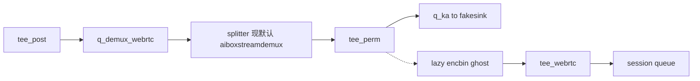

# 16 路 b1/b16 PP-YOLO：任务拆分 + demux 验证计划

## 任务边界（审核重点）

三件事互不绑定：

| 任务 | 目的 | 是否级联 | 当前状态 |
|---|---|---|---|
| **1. 换 demux** | 版本遗留：WebRTC 预览臂 `aiboxcamsplit`（深拷贝）→ `aiboxstreamdemux`（`output-fps=0` 零拷贝） | 否 | **代码已落地并板端重编**；3 路 PP-YOLO 日志已见 `demux→tee_perm`。**HTML 出画尚未用 YOLO26 6 路验收** |
| **2. 16 路 batch=1 PP-YOLO** | 只验证 time-mux 单模型能不能跑通 | 否（单阶段 helmet） | 未开工，等任务 1 HTML 验收通过 |
| **3. 16 路 batch=16 PP-YOLO** | 单组 16 路量化模型；去掉 `aiboxbatchsplit` | 否 | 未开工 |

换 demux **不是** 16 路 PP-YOLO 的前置功能依赖；只是你要求「先换、测成功再进入 16 路跑通」。验收对象是 **分流器工厂是否换成 demux**，不是 PP-YOLO 16 路吞吐。



---

## 已完成（任务 1 代码）

检查点：`5193be0 before change demux element`（空提交，改 demux 前）。

只改了 [src/pipeline/GstPipelineBuilder.cpp](G:\Visteon\August_26\daily_record\8-17\IoT_pipeline0817\src\pipeline\GstPipelineBuilder.cpp)：

- `ValidateFactories` WebRTC 段：读 `AIBOX_WEBRTC_SPLITTER`，默认校验 `aiboxstreamdemux`，仅 `=camsplit` 时校验 `aiboxcamsplit`。
- `BuildWebrtcAnnotatedBranch`：默认 factory=`aiboxstreamdemux`，元素名 `demux_webrtc_<gid>`，`output-fps=0`；lazy 日志 `%s→tee_perm`。
- **未改** `BuildBatch*`、`aiboxbatchsplit`、demux 插件源（0817 插件已是 CP08）。

板端 `ubuntu@192.168.50.185` 已重编 demo。PP-YOLO 3 路 `scripts/ppyolo/webrtc_start3.sh` 日志：

```
[webrtc lazy] ... slot0(cam-001): demux→tee_perm→q→fakesink stub
[webrtc lazy] ... slot1(cam-002): demux→tee_perm→q→fakesink stub
[webrtc lazy] ... slot2(cam-003): demux→tee_perm→q→fakesink stub
```

无 `camsplit→tee_perm`。这只证明**构图接线**换成功，**不等于** HTML 预览可用。

---

## 待你审核：任务 1 的 YOLO26 6 路 HTML 验证计划

用现成 YOLO26 脚本，不新建 snapshot、不测 16 路、不测 batch=16。

### 用什么

- 启动：[scripts/yolo26/webrtc_start6.sh](G:\Visteon\August_26\daily_record\8-17\IoT_pipeline0817\scripts\yolo26\webrtc_start6.sh)
  - snapshot：`config_snapshots/demo_2stage_yolo_serial/pipeline_otm_6cam_webrtc.txt`（`[webrtc] enabled=1`）
  - HTML：`test/webrtc/webrtc-test-6.html`（6 tile，`CAMS=cam-001..006`）
  - 日志：`output/webrtc_6cam/p6_demo.log`
  - 公共体：[scripts/webrtc_start_common.sh](G:\Visteon\August_26\daily_record\8-17\IoT_pipeline0817\scripts\webrtc_start_common.sh) 已 `export AIBOX_WEBRTC_SPLITTER=demux`
- 停止：[scripts/webrtc_stop.sh](G:\Visteon\August_26\daily_record\8-17\IoT_pipeline0817\scripts\webrtc_stop.sh)

### 必须先做的临时修补（否则 HTML 会连错机、拉错流）

YOLO26 stream 仍是旧 RTSP；HTML / 启动脚本仍写死旧板端 IP。**只临时改、测完可还原**，不作为 demux 代码的一部分。

1. **RTSP**：`config_snapshots/demo_2stage_yolo_serial/streams/cam-00{1-6}-otm2.txt` 的 `rtsp_url` 从 `192.168.100.113` 改为 `192.168.50.41`（与当前 PP-YOLO snapshot 一致）。
2. **浏览器入口**：页面默认 NATS 是 `ws://192.168.100.108:8443`（[webrtc-test-6.html:19](G:\Visteon\August_26\daily_record\8-17\IoT_pipeline0817\test\webrtc\webrtc-test-6.html)）。实测时必须改成 `ws://192.168.50.185:8443`（可临时改 HTML 默认值，或你在页面输入框手改）。
3. **URL**：不要用脚本打印的 `http://192.168.100.108:8080/webrtc-test-6.html`（[webrtc_start_common.sh:84](G:\Visteon\August_26\daily_record\8-17\IoT_pipeline0817\scripts\webrtc_start_common.sh) 硬编码）。正确地址：
   - `http://192.168.50.185:8080/webrtc-test-6.html`

本次验证**不改** `webrtc_start_common.sh` 的 HTML 打印 IP（后置清理）。

### 板端步骤（审核通过后才执行）

1. 确认无残留 demo：`pgrep aibox_stream_pipeline_demo` 为空，必要时 `bash scripts/webrtc_stop.sh`。
2. 临时改 6 个 `-otm2` stream 的 RTSP IP，scp 到板端。
3. `export AIBOX_ROOT=/mnt/workspace/8-17/IoT_pipeline0817`
4. `bash scripts/yolo26/webrtc_start6.sh`（`--run-forever`，等你点 HTML；不要设 `AIBOX_RUN_SECONDS`）。
5. 启动门禁：`BOOT_OK` + `AGG_OK count>=6` + `READY_FOR_BROWSER`。
6. 日志门禁（换 demux 的硬证据）：
   - 出现 `demux→tee_perm`（6 条 slot）
   - **不出现** `camsplit→tee_perm`
7. 你在本机打开 `http://192.168.50.185:8080/webrtc-test-6.html`，NATS 填 `ws://192.168.50.185:8443`，点 **Start All**。
8. HTML 验收：
   - 6 路 ICE connected
   - 6 路 video 出画（允许短暂黑屏后出图）
   - Close All → Start All 可再出画
9. 观察 `CmaFree` 不在预览期间单调掉到危险水位。
10. `bash scripts/webrtc_stop.sh` 停进程。

### 通过标准

- 构图：默认走 `aiboxstreamdemux`，日志 `demux→tee_perm`。
- 预览：6 路 HTML 出画 + ICE 正常。
- 失败则停在任务 1，不进入 16 路 PP-YOLO。

可选回退（非必须）：`AIBOX_WEBRTC_SPLITTER=camsplit` 再起一次，日志应变回 `camsplit→tee_perm`，证明开关真接线。

---

## 任务 2 / 3（本轮不执行，仅保留）

**任务 2**：demux HTML 通过后，新建 16 路 **单阶段** PP-YOLO noweb snapshot（`[batching] enabled=0`，不级联），`run_noweb.sh` 短时跑通。不把 demux/HTML 绑进这条。

**任务 3**：`PHASE3_B2_PAIR_ONLY` + `aiboxbatchsplit` MAX_STREAMS=2 是硬阻塞。去 split，改 pre-batch tee + `qtimldemux`，新 b16 snapshot 指向已复制的 `.bin`。16 路满批同步与 HTP/CMA 是实测风险。

---

## 请你拍板

1. 任务 1 验证范围：只用 YOLO26 `webrtc_start6.sh` + `webrtc-test-6.html`，可以吗？
2. 临时改 YOLO26 6 路 RTSP IP 为 `192.168.50.41`、HTML NATS 默认改为 `192.168.50.185`，测完可还原，可以吗？
3. 通过后再做任务 2（16 路 batch=1 noweb），本轮不碰任务 3。
