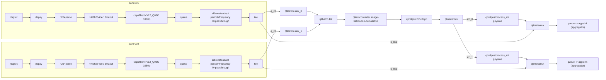
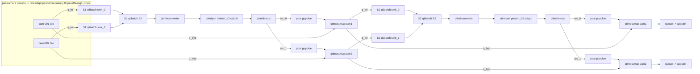
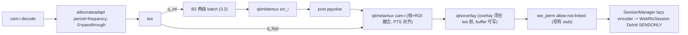

# 将 batch=2 PP-YOLOE 嵌入 0817（以 0817 目录为基准）

> 本轮仅方案。以下命令/改动均待你批准后再执行。所有迁移以 **0817 目录结构为基准**，donor（`I:\...\IoT_pipeline_test_pp-yolo`）仅按符号/依赖借用，**禁止整目录或整文件覆盖**（会回退 0817 的 WebRTC 修复）。

## 0. 已确认决策（本方案据此展开）
- **WebRTC = 方案C优先 / 方案A兜底**：`aiboxrateadapt` 置于 **tee 之前**（推理与预览同源同帧）；WebRTC 取**终端 `qtimetamux` 融合帧（帧+ROI，PTS 对齐）**，不取 tee 生帧。旋钮只有 `target-period`：`0` = 透传满源帧率（方案 C）；`>0` = 同步丢帧（方案 A）。B2 每路经 demux 已独立 → **不需要 aiboxcamsplit**。方案B（满帧率顺滑预览 + ROI 缓存 + meta 注入）降级为可选后续。
- **源帧率解耦 + `target-period=0` 透传**：`[inference] frequency` 只驱动 rateadapt 的 `target-period`，**不探测、不写死 RTSP fps**。`frequency=0` / `target-period=0` = **透传**（不改写 caps、不 drop，等于没装这个插件）——当前 25fps 不想改就走这条。`frequency>0` 才限帧（方案 A）。**不要把 `frequency=40`（25fps）当成保帧**：现实现按 PTS 间隔 drop，源有抖动会误丢。
- **两级构图与现役 YOLO 级联一致，只换 batch 路径**：复用同一套 `algorithm type=serial` + 两级各一 `qtimlqnn`（`shared_model_runtime=false`）+ `class_filter` 分流 + `ResolveHtpDeviceId(stage_index)` 钉 CDSP。YOLO OTM 两级共用同一份 `yolo26_otm_…bin`、filter=Green/Human；B1 PP-YOLO 两级共用同一份 `ppyoloe_helmet`、filter=helmet/person。B2 同样：同一份 B2 权重起两个实例，filter 不变。部署成两个同内容文件名只是方便 snapshot 各指一路，**不是新架构**。差异只在 mux：YOLO/B1 用 `aiboxtimemux`；B2 每级用 `qtibatch→converter→qnn→qtimldemux` 再按相机 metamux 串到下一级。
- **FrameMeta = 单 ABI 库**：迁入 `aiboxframemeta_common`（`libgstaiboxframemeta.so`），meta 结构**末尾追加** `batch_group_id`/`batch_stream_id`（旧字段偏移不变），收敛 timemux/camsplit/demux 的手抄镜像。此为**全进程共享插件换血**：yolo26/B1 现役都依赖同一份 meta，Phase 2 必须整套重编 + 现役回归，**严禁新旧 `.so` 混装或双注册**。
- **相机规模 = 偶数（2/4/6/8，多 B2 组）**；**9 路第 9 路 = `b2_even_b1_nine`**：B2 只覆盖偶数，9 路整体仍走现役 B1/time-mux 作回归，B2 不强求跑 9（固定 batch=2 凑不满奇数）。
- **模型 = scp + sha256 校验**（板端目前无 PP-YOLO bin）。两份同内容 B2 文件（helmet/person 文件名）按 YOLO「同一权重加载两次」部署。

---

## 1. 审查结论（事实）
- **目标 0817 现状 = B1 + 强制 time-mux + WebRTC**。B2 基建全缺：无 `BatchConfig`/`[batching]`、无 `TensorSpec`/`ModelOutputConfig.tensors`、无 `ExecutionMode::kMultistreamBatch`、无 `BatchGroupPlan`/`BatchStreamPlan`/`ExecutionPlan.batch_group_plans`、无 `BuildBatch*`、无 `ValidateBatchConfig`/`BuildBatchGroups`、无 `ParseBatch`/`[output.N]`、无 `RuntimeRegistry::request_pad_handles`、无 `aiboxframemeta_common`/`aiboxrateadapt`。当前 `Build()` 只遍历 `plan.time_mux_group_plans`（`src/pipeline/GstPipelineBuilder.cpp:727`），orchestrator 强制 `kTimeMux`。
- **donor 已验证 B2 能力可迁**：`BatchConfig`+`kMultistreamBatch`+`BuildBatchPipeline/BuildBatchDecodeStream/BuildBatchStage/BuildBatchPerCameraTerminal`+`RequestPadHandle` RAII+`BatchMaskCtx` partial fail-fast+ROI budget fail-fast+`aiboxframemeta_common` 单 ABI+`aiboxrateadapt` 零拷贝调帧+ppyoloe 后处理 caps 双序识别。分派看 `!plan.batch_group_plans.empty()`（`GstPipelineBuilder.cpp:903`），不看枚举。
- **必须保留**：time-mux 主循环；WebRTC Branch C（overlay 在 tee 前 → `tee_post` → `aiboxcamsplit` → `tee_perm` allow-not-linked stub）；`SessionManager::Init/RegisterCamera/EnsureWebrtcEncoder`；`WebRtcSession::DoInit`（link `sink_%u` → SENDONLY + codec-preferences；`sync_state_with_parent` 后同步 `DoCreateOffer`）；main 生命周期（NATS→signaling→PLAYING→tick/bus→Shutdown→NULL wait→release camsplit pads）；CP06 sticky；yolo26-OTM/PP-YOLO B1 现役。
- **ABI/GType/CMake 冲突（须处理）**：0817 现状 `aiboxtimemux` 正式注册 `GstAiboxFrameMeta`，`aiboxcamsplit`/`aiboxstreamdemux` 各自手抄镜像 offset（`gstaiboxcamsplit.cpp:11-20`、`gstaiboxstreamdemux.cpp:11-20`）。选项A要求把注册收敛到 `libgstaiboxframemeta.so` 并去掉镜像。roi 插件 GType 必须保持 `GstMLPostProcessRoi`/`qtimlpostprocess_roi`/`GstMLPostProcessModulesRoi`，禁止与官方 `qtimlpostprocess`/`GstMLPostProcess` 同路径同进程冲突。donor 无 `board_build_unified.sh`，0817 有——须在 0817 脚本增编 `aiboxframemeta_common`+`aiboxrateadapt`。
- **模型/板端未决**：两个 B2 bin（同内容，SHA `6F66E2…D29961`，9,318,400B）需 scp 到板端 `data/models/`；`gst-inspect` 各官方组件属性/pad、`DetectHtpCount()` 实测需 Phase 0 在板上核对（不猜）。

---

## 1.5 官方源码权威结论（grok-4.6 子代理核实，构图须遵守）
- **qtibatch 不强制各路同帧率**（`gst-plugin-batch/batch.c`）：协商剥掉 `framerate` 并取最高 fps 作输出窗；成批 = 尽量等齐 + 按最高 fps `duration` 超时发**部分 batch**，快路无背压。**唯一属性 `moving-window-size`（默认1）——没有 `batch-size`/`timeout`/`output-mode`；batch 路数 = request 的 `sink_%u` 个数**，必须与模型固定 batch(=2) 一致；流存在与否用 `GST_BUFFER_OFFSET` 位掩码编码。
- **同帧率是工程选择而非硬约束**，但**固定 batch=2 + 我们的 partial fail-fast** 使「同组同帧率、每窗满 2 帧」成为实务必需 → 由 rateadapt 归一保证（当前 9 路皆 25fps 天然满足）。
- **qtimldemux 按 protection meta 的 `stream-id` 路由到 `src_%u`（非固定槽位）**：缺一路只是该 `src` 丢一拍，**其余路绝不串台**，demux 不看 framerate；输出 caps 每路 batch 维=1。身份链：sink 创建顺序 = converter 写的 stream-id = demux src 序号，三者必须对齐。
- **converter 必须 `image-batch-non-cumulative`**（muxed 路径 default 即此）：cumulative 会跨窗攒帧、破坏「每路一帧」。
- **官方 batch 示例（gst-ai-multistream-batch-inference）非唯一构图**：结构上仅需 `qtibatch(N×sink_%u)→qtimlvconverter→qtimlqnn→qtimldemux(N×src_%u)` 主干；RTSP 源、是否插 videorate/统一 fps（示例**不做**）、overlay、WebRTC 尾、串级都是自由度；示例对 batch/converter/demux **零属性**、`tensors` 仅 detection 才设。示例是**单级并行多组**；**两级串行是本项目自研组合，无官方模板 → Phase 4 须自验锁步**。我们 QNN **故意不设 tensors**（避 SIGSEGV，见约束）。

---

## 2. 差异矩阵（模块 · 0817现状 · donor B2 · 动作 · 风险 · 验收）

### 配置/规划层
- **`ConfigTypes.hpp`** · 无 batch 结构 · `BatchConfig`/`ModelConfig.batch`/`model_family_id`/`TensorSpec`/`ModelOutputConfig.tensors` · **人工合并**新增字段 · 低 · 编译 + dump-plan-only。
- **`Types.hpp` `ExecutionMode`** · `{kUnknown,kIndependent,kTimeMux}` · 加 `kMultistreamBatch`；`BatchGroupId` 别名 · **人工合并** · 低 · 枚举可用。
- **`Plan.hpp`** · 无 batch plan · `BatchStreamPlan`/`BatchGroupPlan`/`ExecutionPlan.batch_group_plans`/`StreamPlan.assigned_batch_group_id`+`batch_stream_id`/`StagePlan.model_batch`+`batch_group_id`/`InferenceChainPlan.batch_group_id` · **人工合并** · 低 · plan JSON 正确。
- **`TxtSnapshotLoader.*`** · 无 `[batching]`/`[output.N]` · `ParseBatch`+`[output.N]`→`tensors` · **人工合并**（0817 已有 loader 更全）· 中（section 调度顺序）· 解析回读正确。
- **`PipelineOrchestrator.*`** · 仅 time-mux 分组 · `ValidateBatchConfig`+`BuildBatchGroups`+`BuildBatchInferenceChainPlan`+`BuildBatchStagePlans`；入口按 `config.batch.enabled` 分派 · **人工合并**（保住 `kTimeMux` 现役分支）· 中 · 单测 + dump-plan。
- **`PlanExporter`/`PipelineStructureDumper`** · 无 batch 段 · `[BatchGroups]` 段（`[ExpectedGstPipeline]` donor 仍写 time-mux 拓扑）· 迁 `[BatchGroups]`，`[ExpectedGst]` 后补 B2 · 低 · 结构 txt 含 batch 组。
- **`test/batch/test_batch_planning.cpp`** · 无 · 全套 validation 契约 · **新建复制**并适配 0817 结构体 · 低 · `ctest` 通过。

### Builder/运行时层
- **`GstPipelineBuilder.hpp/.cpp`** · 仅 time-mux+WebRTC · `BuildBatchPipeline/DecodeStream/Stage/PerCameraTerminal`+`BatchMaskCtx`+`ConfigQtiml*`+`Build()` 分派 · **人工合并，严禁覆盖**（0817 含更新 WebRTC）· **高** · noweb B2 出结果且不破 WebRTC。
- **`RuntimeRegistry.hpp`** · 无 request pad RAII · `RequestPadHandle`+`request_pad_handles`+`ReleaseAllRequestPads` · **人工合并**（与现有 camsplit pad 释放并存）· 中 · 退出时 pad 全释放。
- **`AppSinkCallbacks.*`** · 无 ROI budget · `TerminalCallbackCtx`(max_roi)+overflow fail-fast(`GST_FLOW_ERROR`) · **人工合并** · 中 · ROI≤预算，超限非零退出。
- **`main.cpp`** · PLAYING/VOID_PENDING 已有；exit code {0,2,3,4,5} · donor `batch_partial_total`/`roi_overflow_total`→exit 1；PLAYING 后导 DOT · **人工合并**（保住 NATS/SessionManager/cleanup 顺序）· **高** · 状态机与退出码正确。

### 插件/ABI 层
- **`aiboxframemeta_common`** · 不存在 · 单 ABI meta（含 `batch_group_id`/`batch_stream_id`）+`libgstaiboxframemeta.so` · **新建复制**，最先构建 · **高**（收敛镜像）· 单注册、各消费者共用。
- **`aiboxtimemux`** · 自注册 meta（`gstaiboxframemeta.hpp/.cpp`）· donor 已删自注册、改 include common · **人工合并**：改 include+链接 common，删除本地注册 · **高**（勿双注册）· time-mux 回归 + 无重复 GType。
- **`aiboxcamsplit`/`aiboxstreamdemux`** · 手抄镜像 offset · 改 include+链接 common · **人工合并** · **高**（WebRTC 预览/录制路径）· WebRTC 3 路回归。
- **`aiboxrateadapt`** · 不存在 · donor 现实现：`target-period` 下限 10ms，**每个 CAPS 都改写 src framerate=`1000/period`，并按 PTS 间隔 drop**（默认 200ms=5fps）。**迁入时必须扩 `target-period=0` 透传**：不改 caps、不 drop、不改 duration。`frequency=0` → 透传；`frequency>0` → 限帧。**置于 tee 前** · **新建复制并改透传** · 中 · `frequency=0` 时下游 caps 仍为源帧率。
- **`mlpostprocess_roi` + ppyoloe 模块** · 0817 已有 ppyoloe 子模块（CLAUDE.md）· donor ppyoloe 有 B1/B2 caps 双序识别 · **对照核验**：确认 0817 ppyoloe 已含双序 union；缺则合入 · 中 · demux 后 B1 tensor 正确解析。
- **`board_build_unified.sh`/CMake** · 编 4 插件 · 需增 `aiboxframemeta_common`(最先)+`aiboxrateadapt` · **人工合并** · 中 · `runtime_plugins/` 产物齐全。

### snapshot/模型层
- **snapshot** · `demo_pp_yolo_2stage_serial`(B1/time-mux) · `demo_pp_yolo_batch_b2`+`_2stage`(含 `[batching]`,`batch=2`,`[output.0/1]` shape `2,8400,4`/`2,4,8400`) · **新建**（偶数 2/4/6/8 变体 + `_webrtc`）· 低 · dump-plan 组数正确。
- **模型 bin** · 板端有 B1；本地/板端无 B2 · donor 本地有 `ppyoloe_helmet_b2…bin`(9,318,400B) · **scp 两份副本**(helmet/person)+`sha256sum` 校验 · 中 · 板端 SHA 匹配才启组。

---

## 3. 最终目标拓扑

### 3.1 单级 B2 noweb（2 路 = 1 组）

### 3.2 两级串行 B2 noweb（每级独立 batch/QNN/demux，双 CDSP）

### 3.3 B2 per-camera WebRTC（方案C优先/A兜底：rateadapt 在 tee 前）

> 关键：rateadapt 置于 tee **之前** → 推理与预览**同源同帧**；`qtimetamux` 的融合帧（帧+ROI，PTS 对齐）**既是 appsink 终端也是 WebRTC 源**，天然满同步、无需 ROI 缓存/注入探针。`frequency=0` = 透传源帧率（方案 C）；HTP 顶不住则设 `frequency>0` 退**方案A**（同步丢帧），预览随之降速但仍满同步。B2 每路已 demux 独立 → **不接 aiboxcamsplit**；overlay 仍须在 tee 前（refcount=1 才可写，见约束5）。
> 图中 `period=frequency` **不是**「自动等于源 fps」。它只表示插件读快照字段；要保 25fps 必须 `frequency=0`（透传），不能指望 `frequency=40`。
> 可选后续（方案B 顺滑预览）：另起 full-rate 预览分支 + 每相机 ROI 缓存（最大陈旧时间）+ meta 注入探针，用满帧率顺滑度换同步精度，仅当方案C/A 顺滑度不达标时再上。

---

## 4. 分阶段实施计划

### Phase 0 — 只读基线 + 板端组件/模型核实（不改代码）
- 录制现役回归基线：yolo26-OTM 3 路 WebRTC、PP-YOLO B1 noweb 1/3 路日志留档。
- 板端 `gst-inspect-1.0` 核对 `qtibatch`(**只有 `moving-window-size`，无 `batch-size`**；sink_%u request pad、GST_BUFFER_OFFSET/channel mask)、`qtimldemux`(src_%u 按 stream-id 路由)、`qtimlqnn`(model/backend/backend-device-id、tensors 类型)、`qtimlvconverter`(mode/image-disposition/subpixel-layout)、`qtimetamux`(mode/latency/data_%u)。核对 `DetectHtpCount()` 与 `/dev/fastrpc-cdsp*`。
- **实测源帧率 + 可持续推理帧率（只记录、不写死）**：`gst-discoverer`/probe 采样 9 路 RTSP 实际 fps（当前实测皆 25fps）；单/两级 B2 空跑量出 HTP 可持续 fps。二者较小值留余量 → 作为 snapshot `[inference] frequency` 初值（rateadapt `target-period`）。
- 核对 0817 `model_path` 相对解析规则（沿用 B1 约定）。
- 部署两份 B2 bin 到板端 `data/models/`（helmet/person，内容同 SHA），`sha256sum` 校验。
- 依赖：无。回退：纯只读。验收：清单成文 + 板端属性/pad/SHA + 源 fps/可持续 fps 全部确认。

### Phase 1 — Config/Loader/ExecutionPlan/validation
- 改：`include/aibox/common/ConfigTypes.hpp`(+`BatchConfig`,`ModelConfig.batch`/`model_family_id`,`TensorSpec`,`ModelOutputConfig.tensors`,`SnapshotConfig.batch`)、`Types.hpp`(+`kMultistreamBatch`,`BatchGroupId`)、`Plan.hpp`(+batch plan 结构/字段)、`src/config/TxtSnapshotLoader.*`(+`ParseBatch`/`[batching]`/`[output.N]`)、`src/orchestrator/PipelineOrchestrator.*`(+`ValidateBatchConfig`/`BuildBatchGroups`/`BuildBatchInferenceChainPlan`/`BuildBatchStagePlans`，入口 `config.batch.enabled?kMultistreamBatch:kTimeMux`)、`PlanExporter`/`PipelineStructureDumper`(+`[BatchGroups]`)、新建 `test/batch/test_batch_planning.cpp`。
- 为何：先把"txt→ExecutionPlan"打通并单测，纯规划层零运行风险。
- 依赖：Phase 0。回退：`[batching].enabled=0` 即回 time-mux；分支提交。单测：port donor 全套（`BATCH_*` 错误码 + `[output.N]` 解析 + `test_legacy_still_time_mux`）。板端验收：`--dump-plan-only` 对 B2 snapshot 生成正确 `batch_group_plans`（组数/slot/pad 名）；B1/yolo26 plan 不变。

### Phase 2 — FrameMeta 单 ABI + 插件/构建依赖
- 改：新建 `plugins/aiboxframemeta_common/`(gstaiboxframemeta.h/.cpp+CMake→`libgstaiboxframemeta.so`，含 batch 字段)；`aiboxtimemux` 删本地注册、改 include+链接 common；`aiboxcamsplit`/`aiboxstreamdemux` 去镜像 offset、改 include+链接 common；新建 `plugins/aiboxrateadapt/`（**相对 donor 必改**：`target-period` 下限扩到 0；`=0` 时 CAPS 原样转发、chain 全放行、不改 duration）；`main.cpp`/`GstPipelineBuilder.cpp` 启动加载 `aiboxframemeta` 插件；`scripts/board_build_unified.sh`+顶层 CMake 增编两新插件（common 最先）。核验 0817 ppyoloe 后处理模块是否已含 B1/B2 caps 双序 union，缺则合入。
- 为何：选项A 要求全进程单一 meta ABI；rateadapt 透传是「当前 25fps 不改」的唯一可靠开关。
- 依赖：Phase 1。回退：git 分支；保留旧镜像分支可快速还原。单测：无（编译期）。**板端回归验收（关键）**：重编后跑 yolo26-OTM 3 路 WebRTC（ICE+出画+Close/Start ×3）与 PP-YOLO B1 noweb，确认 time-mux/WebRTC/NATS/lazy encoder 无回归、无重复 GType、无 not-linked。

### Phase 3 — 单级 B2 noweb（2 路）
- 改：`GstPipelineBuilder.hpp/.cpp`(+`BuildBatchPipeline/DecodeStream/Stage/PerCameraTerminal`+`BatchMaskCtx`+`ConfigQtimlVConverter/Qnn/PostProcess`；`Build()` 首行 `if(!plan.batch_group_plans.empty()) BuildBatchPipeline...`)、`RuntimeRegistry.hpp`(+`RequestPadHandle`/`request_pad_handles`/`ReleaseAllRequestPads`)、`AppSinkCallbacks.*`(+`TerminalCallbackCtx` max_roi)、`main.cpp`(+`batch_partial_total`/`roi_overflow_total`→exit 1；PLAYING 后导 DOT)。QNN **不设 tensors 属性**；`htp_id=stage_index%htp_count`。新建 `config_snapshots/demo_pp_yolo_batch_b2/`(2 路单级)。
- 为何：最小可运行 B2 主链，验证官方 qtibatch 形态。
- 依赖：Phase 2。回退：`batch.enabled=0`。板端验收（60s）：`current==PLAYING && pending==VOID_PENDING`；默认 `frequency=0` 时 rateadapt 透传（src caps=源帧率、drop=0）；`frequency>0` 时 `rateadapt.src`=`1000/frequency` 且 `qtibatch.sink_0/1` 同值；QNN 输出 B2 shape；demux 后每路有效 B1；camera_id/frame_id/PTS 不串路、两路锁步；`BATCH_PARTIAL=0`、`ROI_OVERFLOW=0`、每帧 ROI≤results(50)；0 not-linked/0 CRITICAL/0 GST_ERROR；正常退出；request pad 全释放。

### Phase 4 — 两级串行 B2 noweb（双 CDSP 双 bin）
- 改：`BuildBatchPipeline` 按现役 YOLO 同一套 `InferenceChainPlan.stage_ids` 串行（`shared_model_runtime=false`）；`stage_outputs`(per-cam metamux)→下一级 `video_inputs`；两级各独立 qtibatch/qnn/demux（这是相对 YOLO time-mux 的**唯一结构差**）；两级 `qtimlqnn` 仍走现有 `ConfigQtimlQnn` + `ResolveHtpDeviceId(stage_index)`（与 YOLO 相同，不另写钉核逻辑）；`class_filter` 与 B1 PP-YOLO 一致（S1=helmet 类、S2=D_person）；`max_roi=Σstage.results`。新建 `demo_pp_yolo_batch_b2_2stage/`（两级 `models/*.txt` 可指向同内容两文件名，等同 YOLO 两级共用同一 `model_id`）。
- 为何：级联语义与 YOLO 对齐，只把 mux 从 time-mux 换成官方 qtibatch。
- 依赖：Phase 3。回退：切回单级 snapshot。板端验收（60s）：AGG 有 helmet+person，drop=0；终端 ROI≤两级 results 之和(100)；两路锁步、无串路；两 CDSP 各一实例；正常退出。

### Phase 4.5 — caps/partial/ROI/长稳根治 + 偶数扩展
- 内容：故障注入验证 partial fail-fast（丢一路→`GST_PAD_PROBE_DROP`+bus ERROR+非零退出）与 ROI overflow fail-fast（不提交错误结果）；确认 CP06 sticky 未破；4 路(2 组)扩展；10 分钟长稳。
- 依赖：Phase 4。回退：回 2 路。板端验收：4 路稳定；fail-fast 三项（DROP/bus ERROR/exit≠0）实测；长稳 submitted 持续增长、0 泄漏。

### Phase 5 — per-camera WebRTC（方案C优先/A兜底）
- 改：每相机 `aiboxrateadapt` 置于 **tee 前**（`frequency=0` 透传 / `>0` 限帧）；终端 `qtimetamux` 融合帧（帧+ROI）既进 appsink 也进 WebRTC：融合帧→`qtivoverlay`(tee 前, 可写)→复用现有 `tee_perm` stub→`SessionManager` lazy encoder→`DoInit` SENDONLY。**B2 每路已 demux 独立 → 不接 aiboxcamsplit**。方案C：`frequency=0` 保源帧率满同步；不稳则设 `frequency>0` 退**方案A**，无需改结构。新建 `demo_pp_yolo_batch_b2_2stage_{2,4,6,8}cam_webrtc.txt` + 对应脚本/HTML（沿用现有 multi/6 框架，偶数）。
- 为何：rateadapt 在 tee 前 → 推理/预览同源同帧；`target-period=0` 是保 25fps 的可靠开关。
- 依赖：Phase 4.5。回退：`webrtc.enabled=0` 回 noweb。板端验收：2 路→4 路 WebRTC，ICE + 透传时源帧率出画、框与画面 PTS 对齐（满同步），Close/Start 可重复；yolo26/B1 WebRTC 与 NATS/lazy encoder 无回归。
- 可选后续（方案B）：仅当方案C/A 顺滑度不达标时，再加 full-rate 预览分支 + 每相机 ROI 缓存（最大陈旧时间）+ meta 注入探针，用顺滑度换同步精度。

### Phase 6 — FPS 与 T1–T4 性能测量（单独）
- 功能基线通过后再加测量，减少变量。注意 fpsdisplaysink 回调后两参数官方语义为 droprate/avgfps（非 min/max）。

---

## 5. 文件级迁移清单
- **可复制后适配（新文件）**：`plugins/aiboxframemeta_common/*`、`plugins/aiboxrateadapt/*`、`test/batch/test_batch_planning.cpp`、`config_snapshots/demo_pp_yolo_batch_b2/*` 与 `demo_pp_yolo_batch_b2_2stage/*`（按 0817 路径/相机命名适配）。
- **只能人工合并（严禁覆盖，0817 含更新 WebRTC）**：`GstPipelineBuilder.hpp/.cpp`、`main.cpp`、`ConfigTypes.hpp`、`Plan.hpp`、`Types.hpp`、`TxtSnapshotLoader.hpp/.cpp`、`PipelineOrchestrator.hpp/.cpp`、`RuntimeRegistry.hpp`、`AppSinkCallbacks.hpp/.cpp`、`PlanExporter.cpp`、`PipelineStructureDumper.hpp/.cpp`、顶层 `CMakeLists.txt`、`plugins/aiboxtimemux/*`、`plugins/aiboxcamsplit/*`、`plugins/aiboxstreamdemux/*`、`plugins/mlpostprocess_roi/*`、`scripts/board_build_unified.sh`。
- **禁止覆盖的目标文件**：`src/webrtc/*`、`include/aibox/webrtc/*`、`GstPipelineBuilder.cpp` 整体、`main.cpp` 整体。
- **需新建 B2 snapshot**：单级 2 路 + 两级 2/4/6/8 路 + `_webrtc` 变体；两级各含独立 `models/*.txt`(helmet/person 各指一 bin)、`algorithms/*`、`streams/cam-00N_batch.txt`、`labels/helmet_labels.json`、`models/MANIFEST.md`。
- **9 路不新建 B2**：沿用现役 `demo_pp_yolo_2stage_serial` B1/time-mux 9 路快照做回归（`b2_even_b1_nine`），B2 只覆盖偶数。
- **需编译/部署 .so**：`libgstaiboxframemeta.so`(最先)、`libgstaiboxrateadapt.so`、重编 `libgstaiboxtimemux.so`/`libgstaiboxcamsplit.so`/`libgstaiboxstreamdemux.so`、`libgstqtimlpostprocess_roi.so`+ppyoloe 模块 `.so` → `runtime_plugins/`。
- **需纳入 MANIFEST/SHA 的模型**：两份 B2 bin（内容同，SHA `6F66E2…D29961`）；scp 后板端 `sha256sum` 校验，mismatch 不启该组。

---

## 6. 验收标准（汇总门槛）
- pipeline `current==PLAYING && pending==VOID_PENDING`（非 ASYNC_DONE 误判）。
- `frequency=0`：`rateadapt` 透传，下游 caps/到达率 = 源帧率。`frequency>0`：`rateadapt.src` = `1000/frequency`，`qtibatch.sink_0/1` = 同值。源 fps 不写死。
- QNN 输出 B2 shape 正确（`2,8400,4` / `2,4,8400`）；demux 后每路有效 batch=1。
- camera_id/frame_id/PTS/batch_stream_id 不串路；两路有效帧锁步。
- `BATCH_PARTIAL=0`；`ROI_OVERFLOW=0`；单级每帧 ROI≤该 stage results；两级 terminal ROI≤两级 results 之和。
- submitted 持续增长；0 not-linked；0 CRITICAL；0 GST_ERROR；正常退出；request pad 全释放。
- 两级两实例分别落在 CDSP0/CDSP1。
- **回归不受影响**：B1/time-mux、yolo26-OTM 3/6/9、现有 WebRTC/NATS/lazy encoder；9 路走 B1（`b2_even_b1_nine`）不变。

---

## 7. 风险与仍需你确认/板端核实的问题
- 板端 `gst-inspect` 实测属性/pad 名与 `DetectHtpCount()`（Phase 0 现场确认，不猜）；重点确认 `qtibatch` **确无 `batch-size` 属性**（batch 路数=sink 个数）。
- 两份 B2 bin 的板端最终文件名（建议 `ppyoloe_helmet_b2_native_u8_w8a16_preserve.bin` 与其同内容副本 `ppyoloe_person_b2_native_u8_w8a16_preserve.bin`）——是否接受用同内容副本命名区分？
- 目标帧率：默认 B2 snapshot 用 `frequency=0`（透传，保当前 25fps）。HTP 顶不住再改 `frequency>0`，不改结构。后续 RTSP fps 变化：透传模式自动跟随；限帧模式只改配置。
- 方案C 顺滑度：满源帧率顶不住则设 `frequency>0` 退方案A；仅当仍不满意才上可选方案B（缓存+注入，阈值建议 1–2 个推理周期 200–400ms）。
- 偶数扩展上限（2/4/6/8）中，多组共用 2 个 CDSP 的调度是否接受串行化延迟（Phase 6 量化）。