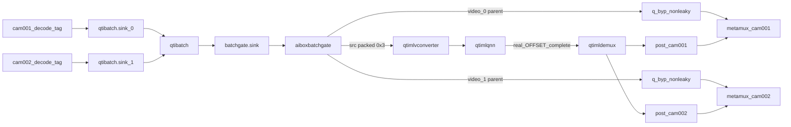

# 将 batch=2 PP-YOLOE 嵌入 0817（post-qtibatch batch-level gate）

> **2026-08-18 SUPERSEDED**：生产拓扑改为 `qtibatch.src → leaky=downstream → aiboxbatchsplit`（抽 parent / 分叉 / 静默丢 0x1/0x2，无 credit、无 lockstep）。见 `aiboxbatchsplit_atomic_gateless` 计划。下文 gate/credit/lockstep 规则作历史记录保留，builder 不再实例化 `aiboxbatchgate`。
>
> 以 **0817 目录为基准**，donor 仅按符号借用，**禁止整文件覆盖**。
>
> **2026-08-17 架构更正（取代入口 Chain Gate）**：官方 `qtibatch` 用持续推进的绝对 `endtime`。入口 credit gate 在 QNN 期间停送，会把第二次顺序 `push sink_0` / `push sink_1` 拆成 `0x1` 然后 `0x2`。生产拓扑改为两路 decode **持续**送 `qtibatch.sink_N`，在 `qtibatch.src` 后用 `aiboxbatchgate` 只准入完整 packed `0x3`。
>
> **审批状态**：Phase 0 / 1 / 2 / 2.5 已完成（结论保留）。Phase 3 按 R0→R1→R2→R3→R3.5→R4 执行。**Phase 4 设计已选定**（§6：yolo26 同构 metamux 串联 + lockstep `qtibatch_s2`；实现尚未开始）。0.1 分派 / 0.2 ABI / 0.3 零侵入 / 0.4 旧语义 / 0.6 回退 **仍然有效**。

## 已废止条款（不得再当实现依据）

权威计划此前下列句子 **作废**：

- 「每个 B2 group 只在整条链路入口放一个 `aiboxbatchgate`」
- 「gate 必须在 Stage1 两个 tee 之前」
- 「用 credit gate 暂停 qtibatch 输入直到 QNN 完成」
- 「Stage2 不插第二个 gate，只在 Stage2 qnn.src 还入口 credit」
- 「一个 BATCH_PARTIAL 立即 `GST_ELEMENT_ERROR`」
- `OnBatchSrcProbe` 把 `OFFSET_NONE` 当完整 B2 放行
- `OnQnnCompleteBatchProbe` 忽略 buffer、固定 `complete-batch(0x3, TRUE)`
- `run_phase3_noweb.sh` 以「出现一次 complete-batch」为通过
- Phase 3「gate→tee→qtibatch」
- Phase 4「Stage2 不插 gate / 只在 S2 还入口 credit」

Phase 2.5 落地的 **per-stream request pad**（`sink_%u`/`src_%u`）契约一并废止。保留唯一 GType 名 `GstAiboxBatchGate` / factory `aiboxbatchgate`（0.3 零侵入仍有效）。R2 **重做 pad 与状态机**。

## 0. 现行决策（2026-08-17）

- **post-qtibatch batch-level gate**：两路 decode 持续送 `qtibatch.sink_N`，不因 QNN credit 暂停。gate 在 `qtibatch.src`：只对完整 packed B2 做有界准入。
- **`0x3` 才能进固定 `batch=2` 的 QNN**。`0x1`/`0x2` 是官方允许的 **partial output**，不是完整 B2 后的 per-slot view；`drop_partial++`，不耗 credit，不进 QNN，不进 bypass。
- **`0x3 && credit==1`**：校验 2 个 `GstParentBufferMeta` + FrameMeta 后同时推出 packed `src` 与 `video_0`/`video_1`。
- **`0x3 && credit==0`**：最多保留 **一份** 最新 pending，替换旧 pending 并 `drop_overload++`。
- **QNN 双检查**：`qtimlqnn.sink` 与 `.src` 都校验真实 OFFSET==0x3 且 tensor batch==2 后，才 `complete-batch(real_mask, true)`。有 pending 则立即准入最新一份。
- **bypass 映射**只信 `FrameMeta.batch_stream_id`（0→`video_0`，1→`video_1`），禁止按 parent 遍历顺序猜 camera。
- **`q_byp` 仍 non-leaky**。不插 `aiboxrateadapt`。`frequency>0` 禁止。
- **只改 B2 分派分支**。B1 / YOLO26 / time-mux / `src/webrtc/*` 禁止动。
- **B1/B2 分派互斥、FrameMeta ABI、零侵入、旧 snapshot 语义、二进制回退**：见下方 **0.1–0.6（未改）**。
- **禁止**：允许 `0x1/0x2` 进 QNN；`OFFSET_NONE` 当完整 B2；只删 DROP 当修复；改 `moving-window-size`；`frequency>0` / `aiboxrateadapt`；改官方 qtibatch；每批 flush/重启 qtibatch；污染 `scripts/` 根目录；SIGKILL / 无证据 `reset_vpu`。
- **Phase 4 专属禁止**：S2 吃 `tee(gate.src)` 未推理 packed 或 S1 张量；lockstep 未齐就推 `qtibatch_s2` 任一路；并联同时跑 S1/S2；为 S2 再插第二只 `aiboxbatchgate`；恢复「只在 S2 还 credit 而不要求 S1/metamux 完成」；改入口 gate 的 pad/状态机。

## 0.1 B1 / B2 运行时分派（互斥，强制）

Builder 唯一分派条件：

```cpp
if (config.batch.enabled &&
    plan.execution_mode == ExecutionMode::kMultistreamBatch &&
    !plan.batch_group_plans.empty()) {
  BuildBatchPipeline(...);
} else {
  BuildExistingTimeMuxPipeline(...);  // 现有 GstPipelineBuilder::Build() time-mux 主循环
}
```

`[batching]` 缺失或 `enabled=0` 时 **必须**：
- `execution_mode = kTimeMux`
- `batch_group_plans` 为空
- 走既有 time-mux 路径
- **不**创建 `aiboxbatchgate`
- **不**请求 `qtibatch` pad
- **不**安装 batch QNN completion probe
- **不**写入 batch runtime registry（无 `BatchGroupRuntime` / `batch_gate`）

`model.batch=1`（现有 PP-YOLO B1）**不得**进入 B2。只有 `[batching].enabled=1` 且校验通过的合法 B2 group 才进入 `BuildBatchPipeline`。非法 batch 配置 **fail-fast**，禁止静默退化成「部分相机 B2、部分 time-mux」。

## 0.2 FrameMeta ABI 全量替换单元（不可拆分）

同一次构建、同一次部署、同一次回退：
- `libgstaiboxframemeta.so`
- `libgstaiboxtimemux.so`
- `libgstaiboxcamsplit.so`
- `libgstaiboxstreamdemux.so`

禁止新旧混装。验收 **不能**只靠编译通过或单独 `gst-inspect`：
- FrameMeta 结构仅在 common 库注册一次
- 新字段只追加在结构体末尾，旧字段偏移不变
- timemux / camsplit / streamdemux **不再编译或导出**本地 FrameMeta 镜像
- 上述依赖插件显式链接 common
- 板端逐个确认 `DT_NEEDED` / `RPATH`（或等价动态依赖）指向新 common
- 同一进程加载全部插件时：无 duplicate GType、无重复 meta 注册

`aiboxbatchgate` **不**并入上述四件套。

## 0.3 `aiboxbatchgate` 对 legacy 零侵入

即使 `.so` 已在 `runtime_plugins/`，也不得影响 B1/YOLO26 插件扫描与运行。

全局唯一名称（禁止复用任何现有 GType）：
- plugin name: `aiboxbatchgate`
- factory name: `aiboxbatchgate`
- GType: `GstAiboxBatchGate`

禁止注册或复用：`GstAiboxFrameMeta`、`GstMLPostProcess`、`GstMLPostProcessModules`、任何现有 timemux/camsplit/demux 的 GType 名。

- B1/time-mux Builder **不**创建 `batch_gate`
- B1 运行时 **不**依赖 `complete-batch` action signal
- YOLO26 **不**链接、不引用 batch gate runtime context

## 0.4 配置解析默认旧语义（Phase 1 回归）

- 不含 `[batching]` 的全部旧 snapshot：导出 `ExecutionPlan` 必须与迁移前基线等价
- B1 PP-YOLO 即使有 `model.batch=1`，也不得生成 `batch_group_plans`
- YOLO26/OTM snapshot 不得生成 `batch_group_plans`
- `[output.N]` / `TensorSpec` 只在 `batch.enabled=1` 时参与 B2 校验
- batch 配置不合法 → fail-fast，禁止静默混跑

`--dump-plan-only` 基线比较（未上板即可发现误分派）：
- 旧 B1 snapshot：迁移前后 `ExecutionMode`、`time_mux_group_plans`、`stage_ids`、camera mapping 必须相同
- 旧 YOLO26 snapshot：同上字段必须相同

## 0.5 前置回归门槛（R3→R4 阻塞，不是最终附带测试）

「只改 B2 分支」不够：Builder、RuntimeRegistry、插件加载与部署仍可能伤 legacy。**R3 之后、R4 B2 板端验收之前**必须先过：

PP-YOLO B1：
- dump-plan 仍为 `kTimeMux`
- noweb 正常运行并正常退出
- 不创建 `aiboxbatchgate` / `qtibatch`

YOLO26 / time-mux：
- 现役 3 / 6 / 9 路 time-mux snapshot
- 9 路仍走 B1/time-mux
- 无 batch runtime、无 qtibatch

现有 WebRTC：
- 至少一次 ICE + 出画
- Close → Start 可重复
- 无 GType / not-linked / request-pad 回归

## 0.6 二进制一致回退（不是只关 `batch.enabled`）

`batch.enabled=0` 只能回退 B2 **构图**，无法回退已替换的 FrameMeta ABI。

强制流程：
- 构建产物写入独立 staging 目录
- 生成 `runtime_plugins` MANIFEST + SHA-256
- common 库及其依赖插件 **一次性切换**
- 部署前保留完整旧 `runtime_plugins` 备份
- 任一 B1 / YOLO26 / WebRTC 回归失败：整组插件回退到备份，而不是只关 `batch.enabled`

---

## 1. 根因（官方 qtibatch，不再猜测）

`qtibatch` 每次建输出先 `GST_BUFFER_OFFSET=0`，再按实际取到的 sink 置位 `(1<<stream_id)`：

- `0x3` = 完整 B2，才能进固定 `batch=2` 的 QNN
- `0x1` / `0x2` = 官方允许的 **partial output**，**禁止进 QNN**
- 等待用的是持续推进的绝对 `endtime`，不是每次从现在重算
- 超时且任一路 `queue >= depth` 就出 partial，并从该 sink queue 删帧

错误结构 `decode → 入口 credit gate → tee → qtibatch → QNN`：QNN 期间 gate 停送，`endtime` 过期；第二次顺序 push 被拆成 `0x1` 然后 `0x2`。probe DROP 后 QNN 无输出 → `inflight=1` 永不还 credit → 全是 `drop_overload`。

`moving-window-size=1` 不是根因。禁止用 rateadapt / `frequency>0` / 改官方 qtibatch / 调 window / flush 重启 qtibatch 掩盖。

## 2. 目标拓扑（单级，Phase 3-R3）



要点：

- 两路 decode **持续**送 `qtibatch.sink_N`
- gate 在 `qtibatch.src`：只对完整 packed B2 做有界准入
- `video_N` 发 mono caps + sticky（stream-start→caps→segment）；packed `src` 透传 batch caps
- mono caps 来自 R0 验证后的 `group.input_caps`；**不得猜测，不得复用 batch caps**
- admit 先推 `video_0/1` 再推 packed `src`；任一路失败则 ERROR、不伪造 credit
- sink 对 qtibatch 始终 `GST_FLOW_OK`
- 过载测试路径（仅 R4）：`batchgate.src → QNN` 之间可插 `identity sleep-time`，不改 source caps

## 3. `aiboxbatchgate` 新契约

新 pad：

- `sink` always：接 `qtibatch.src`
- `src` always：只出获准的完整 packed B2
- `video_0` / `video_1` request：对应 parent 原始帧

状态：`credit`、`inflight`、`pending_full_batch`（最多 1）、`admitted_batches`、`completed_batches`、`drop_overload`、`drop_partial`、`invalid_batch`。

准入还须：`OFFSET==0x3`、parent meta 数==2、两路 `batch_stream_id` 为 0 和 1、`camera_id` 正确且不重复、size/`n_memory` 与完整 B2 约定一致。失败：`invalid_batch++`，拒绝，不伪造 credit。

`gst_pad_push` **不得持 lock**。`complete-batch` 只校验+计数+唤醒；由独立 `GThread` 推 pending。

连续 partial 超阈值或一路长期进不了 full batch → group degraded/`GST_ELEMENT_ERROR`。单个 partial **不得**杀死 pipeline。

## 4. 五围栏（R3 Builder 阻塞门槛）

R2 可先做设计和单元测试。**进入 R3 Builder 前**，下列五围栏必须已写入本计划且 R0 映射证明成立；缺任一项不得改生产 Builder。

### 围栏 1 — `video_0`/`video_1` 的 caps 与 sticky-event

- `batchgate.sink`：接收 qtibatch 的 packed / separated video caps
- `batchgate.src`：原样转发该 packed caps 给 converter/QNN
- `batchgate.video_0`/`video_1`：发送对应单路 **mono video caps**；第一帧前按 `stream-start → caps → segment` 发送 sticky event
- Builder 将已验证的 `group.input_caps` 注入 gate，作为各 `video_N` 的 mono caps 来源

### 围栏 2 — 一次 admit 的三路输出原子失败

1. 锁内只做 credit/inflight 切换并取得 buffer 引用
2. 解锁
3. 先向 `video_0`/`video_1` 的独立 queue 推 parent buffer
4. 再向 packed `src` 推 B2 wrapper
5. 任一 `push` 非 `GST_FLOW_OK`：立即 `GST_ELEMENT_ERROR`；禁止继续下一组；禁止归还伪造 credit

gate 的 sink chain 在 busy 或 pending 满时必须自行 `unref`/drop 后返回 **`GST_FLOW_OK`**，不得把阻塞或错误回传给 `qtibatch`。

### 围栏 3 — Parent 所有权与映射（硬性）

映射：不依赖 parent meta 遍历顺序，只读 `FrameMeta.batch_stream_id`（0→`video_0`，1→`video_1`）。

所有权：

- wrapper 上的 `GstParentBufferMeta` 仍拥有 parent 引用
- `video_N` 输出只做 `gst_buffer_ref(parent)`
- `pending_full_batch` 持有 wrapper 的**唯一额外**引用
- 替换 pending、FLUSH、EOS、NULL、异常退出必须 `unref` wrapper
- wrapper 释放后由 ParentBufferMeta 自动归还 parent
- **不得** copy/mutate packed wrapper 的 OFFSET、ProtectionMeta、ParentBufferMeta

R0 必须先证明：`mask=0x3` → parent meta 数恰为 2 → 两个 parent 都带 AiboxFrameMeta → `stream_id` 为 0/1 且 `camera_id` 不重复 → parent PTS 与 qtibatch sink 输入对应。不成立则**停止**，改「per-camera PTS cache + admission 通知」，**不得进入 R2 生产实现 / R3**。

### 围栏 4 — QNN 检查点含 `qtimlqnn.sink`

R3 链路：`batchgate.src → converter → qtimlqnn.sink probe → qtimlqnn.src probe`。

必须同时验证：

- `qtimlqnn.sink`：真实 OFFSET `== 0x3`，输入 tensor batch `== 2`
- `qtimlqnn.src`：真实 OFFSET `== 0x3`，输出 tensor batch `== 2`

**删除**固定 `complete-batch(0x3, TRUE)`。只有真实 QNN 输出通过上述校验后，才允许 `complete-batch(real_mask, true)`。

### 围栏 5 — B1 / YOLO26 / WebRTC 是 R3→R4 阻塞门槛

见 **0.5**。失败则回退 B2 Builder 改动，不得宣称 Phase 3 可验收。

## 5. Phase 3 分阶段

R2 可与 R0/R1 并行做**设计与单测**。R3 改生产 Builder 的前置：五围栏已在本计划中 **且** R0 parent/caps 证明成立。R4 前置：围栏 5 的 legacy 回归通过。

### Phase 3-R0 契约观测（只读，5–10s，非验收）

现有 B2 分支只加 first-N / 异常日志：

- `qtibatch.sink_0/1`：到达序号、camera/stream/frame、PTS/duration、size、**CAPS**
- `qtibatch.src`：OFFSET 原值、OFFSET_END、mask、PTS、size、`n_memory`、CAPS、parent meta 数、每个 parent 的 camera/stream/frame/PTS、protection meta
- parent 的**实际 caps 与 segment**（供围栏 1 的 mono caps / sticky 契约）
- `qtimlqnn.src`：真实 OFFSET、PTS、tensor caps/shape、输出序号

预期：第一份成功输入真实 `mask=0x3`；`0x1/0x2` 是两份独立 partial；full `0x3` 含两个 parent 且 `batch_stream_id` 为 0/1；parent PTS 与 sink 输入对应。映射或 parent caps 不成立 → 停，不得进 R2 生产实现 / R3。

### Phase 3-R1 最小契约实验（不接真实 QNN）

板端最小 bin：双路 → `qtibatch` → probe → **fakesink**。脚本放 `test/b2_pp-yolo/`。

必须用**可控 appsrc 或明确 pad-block** 驱动，确保复现：「超过一个 qtibatch deadline 之后，先送 `sink_0` 再送 `sink_1`」。

用例：(1) 连续同频 → 持续 `0x3`；(2) 上述可控超期 + 顺序恢复 → 复现 `0x1` 然后 `0x2`。删除 DROP **仅允许**本实验且下游是 fakesink。

### Phase 3-R2 重构 gate + 单测

改 `plugins/aiboxbatchgate/`；重写 `test/batch/test_aiboxbatchgate.cpp`。除原有 credit/pending 用例外，单测必须覆盖围栏 1–3。`board_build_unified.sh` 仍编此插件，**不**并入 FrameMeta ABI 四件套。R0 映射未证时，R2 代码不得当作已批准的生产实现接入 Builder。

### Phase 3-R3 Builder 只改 B2 分支

改 `GstPipelineBuilder.cpp` 的 `BuildBatch*`：删 Stage1 tee 前入口 gate；decode/tag → `qtibatch.sink_N`；`qtibatch.src` → `batchgate.sink`；`batchgate.src` → conv → **`qtimlqnn.sink` probe** → QNN → **`qtimlqnn.src` probe**；`batchgate.video_N` → `q_byp` → per-cam metamux。

Builder 把 R0 已验证的 `group.input_caps` 注入 gate，作为 `video_N` mono caps。更新 `RuntimeRegistry.hpp`。分派仍走 0.1 三条件。禁止整文件覆盖 Builder/main。

### Phase 3-R3.5 legacy 回归（R4 阻塞）

R3 合入后、R4 B2 noweb 前执行围栏 5。失败则回退 B2 Builder 改动。

### Phase 3-R4 短时验收

改 `test/b2_pp-yolo/run_phase3_noweb.sh`，禁止「一次 complete-batch 即通过」。至少：`completed_batches` 达明确最小值；**后半段仍有 completion**；两路 `submitted` 持续增加；admitted/completed 关系合理；无连续停滞。

正常同 FPS：`PLAYING`/`VOID_PENDING`；full B2 / admitted / completed / 每路 submitted 持续增长；`qtimlqnn.sink` 与 `.src` 真实 mask=`0x3` 且 tensor batch=`2`；能跟上则 `drop_overload=0`；steady-state `drop_partial=0`；ROI 与对应 parent PTS 一致。

过载必须可重复注入：仅在**测试路径**于 `batchgate.src → QNN` 之间加 `identity sleep-time`。不改 source caps。验收：`drop_overload>0`；`pending_full_batch<=1`；`completed_batches` 仍增长；QNN 输入始终 `0x3`；partial 不进 QNN；无旧 ROI 复用；无内存持续涨。

## 6. Phase 4 — yolo26 同构 metamux 串联（设计已定，实现未开始）

选定：**S1(helmet) packed QNN → per-cam `qtimetamux` 挂 S1 metadata → lockstep 对齐 → `qtibatch_s2` → S2(person)**。S2 吃的是挂载后的 `metamux_s1.src`，不是 `tee(gate.src)` 未推理 packed。入口 `aiboxbatchgate` 契约不改；credit 在 S2 完成后还一次。单组 2 路；6 路 = 3 组独立链。所有测试 `run-seconds ≤ 120s`。

已否决：并联 tee 同一份未推理 packed；只把 ROI meta 抄到原 packed 再喂 S2；自研 packer 替代第二个 `qtibatch`；旧「Stage2 不插 gate / 只在 S2 还入口 credit」。

依据：现役 yolo26 / PP-YOLO B1 已是 chained `qtimetamux`（`GstPipelineBuilder.cpp` 时间复用链：`prev → tee → S_n`，`post.text → metamux.data_0`，`metamux.src` 成为下一级输入）。Phase 3 单级 B2 已有 per-cam metamux，只是 `metamux.src` 直接进 appsink。orchestrator 已支持多级 batch（`input_source=stage_<prev>`、`input_crop=full`、各级同 batch）；Builder 唯一拦路是 `PHASE3_SINGLE_STAGE_ONLY`。S2 不能吃 S1 张量（caps 已不是视频）。`0x1/0x2` 根因是官方 `qtibatch` 绝对时间窗 + 两路不同刻到达；S2 改为「同批两路对齐后同刻 push」则应直接出 `0x3`。

### 6.1 拓扑（单组 B2）

入口（与 Phase 3 相同，只服务 S1）：`decode ×2 → qtibatch_s1 → aiboxbatchgate`

- `gate.src (packed 0x3)` → `conv_s1 → qnn_s1(helmet @HTP dev1) → demux_s1`
- `gate.video_N` → `q_byp_s1 → metamux_s1.sink`
- `demux_s1.src_N → post_s1(class_filter=helmet) → text → metamux_s1.data_0`

级联到 S2：

- `metamux_s1.src` → **lockstep pair barrier**（两路同 admitted 批次都到齐才放行）
- 屏障同刻 push → `qtibatch_s2.sink_0/1` → `qtibatch_s2.src`（期望恒为 `0x3`）
- `qtibatch_s2.src` → `conv_s2 → qnn_s2(person @HTP dev0) → demux_s2`
- `metamux_s1.src` 再 tee 一份 bypass → `metamux_s2.sink`
- `demux_s2.src_N → post_s2(class_filter=D_person) → text → metamux_s2.data_0`
- 终端：`metamux_s2 → queue_terminal → appsink`（帧上同时有 S1 helmet + S2 person ROI）

`qtibatch_s2` 若出现 `0x1/0x2`：`GST_ELEMENT_ERROR`（不得静默、不得半批进 S2 QNN）。**不**为 S2 再插第二只 `aiboxbatchgate`（S2 速率已被入口 credit + lockstep 限制为「每准入一批一对」）。6 路 = 3 组并列，互不串路。

```mermaid
flowchart LR
  dec["decode x2"] --> qb1["qtibatch_s1"]
  qb1 --> gate["aiboxbatchgate"]
  gate -->|"src packed 0x3"| conv1["conv_s1"]
  conv1 --> qnn1["qnn_s1 helmet"]
  qnn1 --> dmx1["demux_s1"]
  dmx1 --> post1["post_s1"]
  gate -->|"video_N"| mm1["metamux_s1"]
  post1 -->|"text data_0"| mm1
  mm1 --> barrier["lockstep_barrier"]
  mm1 --> tee2["tee after S1"]
  barrier -->|"same-tick push"| qb2["qtibatch_s2"]
  qb2 --> conv2["conv_s2"]
  conv2 --> qnn2["qnn_s2 person"]
  qnn2 --> dmx2["demux_s2"]
  dmx2 --> post2["post_s2"]
  tee2 --> mm2["metamux_s2"]
  post2 -->|"text data_0"| mm2
  qnn2 -.->|"complete-batch"| gate
  mm2 --> term["appsink"]
```



### 6.2 串联时序 + lockstep + credit

1. 入口 gate 准入一份 packed `0x3`（耗 1 credit，`inflight=1`）。
2. S1 QNN 完成 → demux/post → `metamux_s1` 输出两路已挂 S1 ROI 的单帧。
3. lockstep 屏障按「同一 admitted 批次」对齐两路（`FrameMeta` batch/generation，或成对 PTS）。未齐则阻塞，禁止只推一路进 `qtibatch_s2`。
4. 齐则同刻 `push sink_0` + `push sink_1` → `qtibatch_s2` 出 `0x3` → S2 QNN。
5. `S2 qnn_s2.src` 探针：校验 OFFSET==0x3 且 tensor batch==2 → 发**一次** `complete-batch(0x3,TRUE)` 还入口 credit。
6. 任一级 QNN 输入非 `0x3`，或 `qtibatch_s2` 出 partial → `GST_ELEMENT_ERROR`。

S2 在 S1 metamux 产出之前不动；credit 于 S2 完成后归还。

lockstep 实现落点（R1 选定一种，写入 Builder，不改官方 qtibatch）：

- 优先：两路 `metamux_s1.src` pad block；齐了再 unblock 并连续 push 两路。
- 备选：小 identity/queue + 自定义探针收集一对再转发。
- 禁止：两路各自自由流入 `qtibatch_s2`。

### 6.3 成立前提（硬性围栏）

- 两级 `input_crop=full`。任一级要 `input_crop=bbox` → 本方案须重开。
- **R1 板端先证 lockstep**：对齐后推 `qtibatch` 必须持续 `0x3`、零 `0x1/0x2`。不成立 → 停，不得接 S2 QNN。
- S2 `qtimlvconverter` 必须接受 `qtibatch_s2` 的 packed BatchMemory。S2 的 parent 应是 **metamux_s1 输出帧**（带 S1 ROI），不是 decode 原始帧。
- HTP：`ResolveHtpDeviceId`（S1→dev1、S2→dev0）；单核则退化。并行加速是 Phase 6。
- `tee` 在 **S1 metamux 之后**（给 S2 bypass / S2 metamux），不再从 `gate.src` tee 未推理 packed 给 S2。

### 6.4 禁止项（Phase 4 专属，与 §0 禁止项累加）

- 禁止 S2 吃 `tee(gate.src)` 未推理 packed / S1 张量。
- 禁止 lockstep 未齐就推 `qtibatch_s2` 任一路。
- 禁止并联同时跑 S1/S2。
- 禁止为 S2 再插第二只 `aiboxbatchgate`，或恢复「只在 S2 还 credit 而不要求 S1/metamux 完成」。
- 禁止改入口 gate 的 pad/状态机（Phase 3 契约冻结）。
- 禁止 `aiboxrateadapt` / `frequency>0` / 改 `moving-window-size` / 改官方 qtibatch。
- 过载注入仅测试路径：`identity sleep-time` 插在 S1 或 S2 的 `conv` 前，不改 source caps；总时长 ≤120s。

### 6.5 子阶段（所有测试 ≤2 分钟）

- **P4-D1 设计定稿**：§6 本文。产出即本计划文档。
- **P4-D2 snapshot**：新建 `config_snapshots/demo_pp_yolo_batch_b2_2stage/`，镜像 1stage，算法改 `type=serial` / `stage_count=2`，`[stage.2]` person、`input_source=stage_helmet`、`input_crop=full`、`class_filter=D_person`。`--dump-plan-only`：单组 `stage_ids` 长度为 2、`batch=2`；**6 路切 3 组、各 batch=2**。
- **P4-R1 Builder + lockstep 证明**：放开 `PHASE3_SINGLE_STAGE_ONLY` 为「1 或 2 级」。S1 沿用 `BuildBatchStage`；`metamux_s1.src` 进入 lockstep + `qtibatch_s2` + S2 半段（S2 **无**入口 gate、**无** decode→qtibatch）。先证 6.3 lockstep→`0x3`。
- **P4-R2 串联时序 + credit**：`S2 qnn.src` 探针发一次 `complete-batch`；`RuntimeRegistry` 记 S1/S2 qnn 探针、`qtibatch_s2`、lockstep pad、两级 metamux；partial/`非 0x3` 走 `GST_ELEMENT_ERROR`。
- **P4-R2.5 legacy 回归**：复用 `test/b2_pp-yolo/run_phase3_legacy.sh`，全部 `run-seconds ≤120s`。失败回退 R1/R2。
- **P4-R3 noweb（每次 ≤120s，优先 60s）**：2 路 2 级。正常：S1 metamux 先于 S2；S2 输入 parent 带 helmet ROI；终端同时含 helmet+person；`qtibatch_s2` 无 partial；QNN 两级输入皆 `0x3`；两路不串路；正常退出。过载：sleep 注入且总时长≤120s，`pending_full_batch<=1`、`completed` 仍增长。**6 路（3 组）冒烟同样 ≤120s**。

## 7. 文件

- **改**：`plugins/aiboxbatchgate/*`、`test/batch/test_aiboxbatchgate.cpp`、`GstPipelineBuilder.*`（仅 `BuildBatch*` / batch probe）、`RuntimeRegistry.hpp`、`main.cpp`（仅 batch stats 属性名）、`test/b2_pp-yolo/run_phase3_noweb.sh`
- **新建**：`test/b2_pp-yolo/test_qtibatch_minibin.cpp`、`test/b2_pp-yolo/run_phase3_r0.sh`、`test/b2_pp-yolo/run_phase3_r1.sh`、`test/b2_pp-yolo/run_phase3_legacy.sh`
- **禁止覆盖**：`src/webrtc/*`、`include/aibox/webrtc/*`、Builder/main 整文件
- **B2 Builder 不插入** `aiboxrateadapt`（过载测试的 `identity sleep-time` 仅测试路径、由环境变量打开）

## 8. 验收门槛

- 分派：旧 snapshot dump-plan 与基线等价；B1 运行无 gate/qtibatch/probe
- ABI：同进程无 duplicate GType；失败则整组回退
- R0：`mask=0x3` 的 parent/FrameMeta/caps 映射成立，否则停
- R1：同频持续 `0x3`；超期顺序恢复复现 `0x1` 然后 `0x2`
- R2：单测覆盖围栏 1–3
- R3.5：围栏 5 legacy 通过
- R4：禁止一次 complete-batch 即通过；正常/过载两项都过
- request pad/probe 全释放
