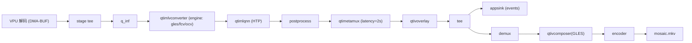

# Converter 引擎复测：先 gles 后 fcv（人工审核卡点）

## 唯一改动点（严格约束）

只改 [`src/pipeline/GstPipelineBuilder.cpp`](src/pipeline/GstPipelineBuilder.cpp) 中 `ConfigQtimlVConverter` 的这一行（第 694 行）：

```cpp
static const std::vector<std::string> kEngines = {"ocv", "gles"};
```

- 测 gles：临时改为 `{"gles"}`（单一候选，避免静默回退到 ocv，确保真的在用 gles）。
- 测 fcv：临时改为 `{"fcv"}`。

**禁止改动**（保持当前正常功能）：
- `qtimetamux` `latency=2s`（检测持续性修复）
- 录制拓扑 `metamux → qtivoverlay → tee → {appsink, demux}`（画框修复）
- converter 的 `mode/image-disposition/subpixel-layout`
- 录制尾 composer/encoder、reset_vpu.sh、demux output-fps 等一切其它设置

## 执行纪律（避开已知坑）

- 每个引擎都必须：**reboot → 首跑带 record**（规避 FastCV 连跑 SIGSEGV、老化态）。
- 不开高 `GST_DEBUG`（`qtivoverlay:5` 长跑会 `Too many open files` → trap）。
- 运行时长沿用用户原指令：`--run-seconds 30`，`--tile-w 320 --tile-h 240 --mosaic-cols 4`。
- 每次产出 MKV 后**停下**，把 MKV + 抽帧下载到本地供用户审核，不自动进入下一个引擎。

## 阶段 A：gles

1. 改 `kEngines = {"gles"}` → pscp 同步源码。
2. 板端 `cmake --build ... aibox_stream_pipeline_demo` 重编 → `sudo reboot`。
3. 待板上线 → `reset_vpu.sh` → 跑 30s `--record`。
4. 采集：`cameras=16` / 干净 NULL / persist / MKV duration+frames / `not writable`+`Failed to apply overlays` 计数 / 抽帧。
5. **下载完整 MKV + 抽帧到本地 → 停，等用户审核。**

参考脚本：可复用/微调 [`test/phase5_record/_fix_conv_gles.sh`](test/phase5_record/_fix_conv_gles.sh)（把判据改成单一 `{"gles"}`，并把完整 MKV 拉回本地）。

### 卡点 1（用户审核 gles 视频）
- 用户认可 → 进入阶段 C（定版 gles）。
- 用户否决 → 进入阶段 B（试 fcv）。

## 阶段 B：fcv（仅当用户否决 gles 后执行）

1. 改 `kEngines = {"fcv"}` → 同步、重编 → `sudo reboot`。
2. `reset_vpu.sh` → 跑 30s `--record`。
   - 预期风险：coredump 曾实证 `fcvVar` 在录制路径崩；若 `Segmentation fault`，如实记录（这本身就是审核结论之一）。
3. 采集同上 → **下载完整 MKV + 抽帧 → 停，等用户审核。**

### 卡点 2（用户审核 fcv 视频）
- 用户认可 → 阶段 C 定版 fcv。
- 用户否决/崩溃 → 阶段 C 回退到已知稳定的 `{"ocv","gles"}`。

## 阶段 C：定版

- 按用户在卡点的结论，把 `kEngines` 设为最终选择（`{"gles"}` / `{"fcv"}` / 回退 `{"ocv","gles"}`）。
- 同步、重编，reboot 后跑一次 30s record 收尾确认（cameras=16 / persist / MKV 完整）。
- 在 [`plan/session_handoff_20260709_detection_dropout.md`](plan/session_handoff_20260709_detection_dropout.md) §3.6/§3.7 追加本次 gles/fcv A/B 的实测数据与最终选择。

## 数据流参考



注：本次只换 `conv` 的引擎；`gles` 预处理会与录制尾 `comp(GLES)` 抢 GPU（历史 A/B 曾致 cameras=0/空 MKV），这正是要用真实录制复核的点。