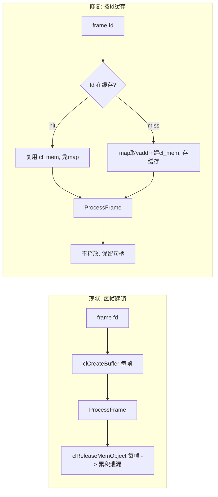

# 修复 face_infer 渐进式卡死（dma-buf 导入泄漏根治）

## 修正后的根因（依据"开始正常→逐渐卡段→卡死"）

不是初始化阻塞（那样会一开始就 raw=0），而是**渐进式资源累积**：

```247:272:plugins/qtifaceinfer/gst_plugin/gstfaceinfer.cpp
    /* Per-frame cl_mem import (same pattern as overlay plugin) */
    ...
        nv12_cl = ocl->CreateBuffer (ctx, flags, plane.frame_len, &ionmem, &rc);
    ...
        faces = priv->processor->ProcessFrame (nv12_cl, plane);
        if (ocl) { ocl->ReleaseMemObject (nv12_cl); }
```

`transform_ip` **每帧**从 dma-buf fd 新建 cl_mem、用完即销。6 路高帧率下，Adreno 上反复导入/释放累积 GPU 虚拟地址/GBM 映射且释放被延迟回收，逐渐"钉住"解码器 dma-buf 池 → 先卡段、最终池耗尽卡死；`mmap: Invalid argument` 频率随时间升高即其表现。leaky 队列只改泄漏速率、不改无界趋势，故治不了。

已排除的次要嫌疑：`GstFaceDetectionMeta` 的 free 函数已注册且数据内联，无 RAM 泄漏。

## 修复思路：按 fd 缓存 cl_mem 导入（无界→有界）

v4l2 解码器/中间元件用固定 bufferpool，fd 是**有限且循环复用**的一组（几十个）。缓存后总导入数被钉死在池大小，此后零新增导入。



关键安全点（均已核实）：
- `RunScrfd` 仅把 cl_mem 作 kernel 入参且 `clFinish` 收尾，跨帧复用安全。
- `CL_MEM_HOST_IOCOHERENT_QCOM` IO 一致，命中时可跳过 `gst_video_frame_map`，顺带消除每帧 mmap。
- cl_mem 是按 fd 建立的内存视图，**不持有 GstBuffer 引用**，不阻碍解码器回收复用。

## 具体改动（集中在一个文件）

文件：`plugins/qtifaceinfer/gst_plugin/gstfaceinfer.cpp`

1. 扩展私有结构 `_GstFaceInferPrivate`：
   - 新增 `std::unordered_map<int, cl_mem> fd_cache;`
   - 新增缓存命中/导入计数 `guint64 n_import=0, n_hit=0;`（诊断用）
   - 可选 `std::mutex cache_mtx;`（stop 与 streaming 理论上不并发，加锁做保险）

2. 重写 `transform_ip` 的导入段：
   - 取 fd（`gst_buffer_peek_memory` + `gst_fd_memory_get_fd`，无需先 map）。
   - `fd_cache` 命中 → 直接复用 cl_mem；plane 信息用缓存条目里保存的（或按 caps 计算）；**跳过 `gst_video_frame_map`**。
   - 未命中 → `gst_video_frame_map(GST_MAP_READ)` 取 vaddr + plane，`CreateBuffer` 建 cl_mem，存入缓存，`unmap`。
   - **移除每帧 `ReleaseMemObject`**。
   - 每 N 帧打印一次 `[faceinfer] cache size=.. import=.. hit=..` 验证有界。

3. 缓存生命周期与释放顺序：
   - 新增 `flush_fd_cache()`：遍历 `fd_cache` 调 `ocl->ReleaseMemObject` 后 `clear()`。
   - `gst_face_infer_stop()`：**先 `flush_fd_cache()`（此时 OpenCL context 仍有效），再 `processor->Destroy()`**，避免释放 cl_mem 时 context 已销毁。
   - `gst_face_infer_set_caps()`：若发生 caps 变更/重协商（池可能重建），先 `flush_fd_cache()` 再继续。

4. 崩溃兜底（确认存在，缺则补）：`gst_face_infer_stop()` / `gst_face_infer_finalize()` 用 try/catch 包裹清理，防 QNN/OpenCL 清理抛 `std::bad_alloc` 穿越 C 边界 terminate。

不改：检测语义（仍每组独立、每帧检测、best-effort）、meta、编排表结构。

## 构建 / 部署 / 验证

1. 板端仅重编插件：`cd plugins/qtifaceinfer && cmake -S . -B build_board -DCMAKE_BUILD_TYPE=Release && cmake --build build_board -j4`，拷贝 `libgstqtifaceinfer.so` 到 `runtime_plugins/`。
2. 确认 `[face] enabled=1`，运行 `scripts/yolo26/webrtc_start6.sh`。
3. **持续跑 5-10 分钟**，监控趋势是否由"漂移"转为"平稳"：
   - `ls /proc/<pid>/fd | wc -l`
   - `CMA_FREE`（vpu_health 输出）
   - `mmap: Invalid argument` 出现频率
   - 各路 raw fps 是否稳定、AGG/TERMINAL 持续输出
   - `[faceinfer] cache size` 应快速收敛到池大小后不再增长

## 成功判据
- 长时间运行不再出现卡段/卡死，6 路 raw fps 稳定。
- fd 数 / CMA_FREE / mmap 频率随时间平稳（确认根治，而非缓解）。
- HTML 预览画面流畅 + 人脸涂白正常；反复开关浏览器不崩溃。

## 若仍缓慢漂移（次要泄漏兜底）
- 加查 QNN 每次 `graphExecute` 是否有累积（scrfd_infer QnnInferencer）。
- 复核 `DmaSyncGuard` / 输出缓冲路径。
- 这些仅在缓存修复后曲线仍不平稳时才介入。

## 回退
- `[face] enabled=0` 一键回到已验证的纯 yolo26 正常路径。