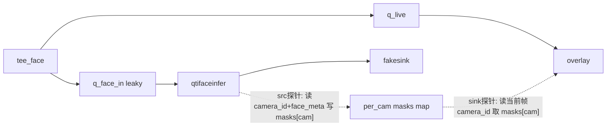

# 修复人脸涂白消失（旁路 + 按摄像头分桶）

## 根因（已用代码坐实）

`AiboxFrameMeta` 每个 buffer 都带 `camera_id`，timemux 输出是**按摄像头轮询的单帧流**（一帧一台，不是拼接大图）。

旁路当前用「每组一个全局 `FaceMaskStore.masks` 字符串」：
- face 支路把最近一次检测框写进全局 store；
- overlay 对**每一帧**都套用这个全局 store。

但直播是 cam-1/2/3 轮流过。overlay 画 cam-2 帧时，store 里往往是 cam-1 的框（cam-1 坐标系），3 台混一个桶 → 绝大多数帧坐标错位、落到画面外 → 视觉上"白框全没了"。

内联版能涂白是因为 overlay sink 探针读的是**当前帧自己的 meta**（同摄像头/同帧/同分辨率）。旁路把 meta 与帧解耦，必须按 `camera_id` 重新对齐。

## 方案：store 按 camera_id 分桶（保留旁路，直播不阻塞）

每台摄像头用自己的最新框、自己的坐标系 → 涂白正确；直播仍不等推理 → 画面流畅；白框相对人脸有几十~一两百毫秒滞后（best-effort，可接受）。

## 具体改动（仅一个文件）

文件：[src/pipeline/GstPipelineBuilder.cpp](src/pipeline/GstPipelineBuilder.cpp)

1. `FaceMaskStore` 由单字符串改为按摄像头分桶：
   - `std::mutex mu;`
   - `std::unordered_map<std::string,std::string> per_cam;`（key=camera_id，value=masks 字符串）
   - `std::atomic<int> refs;`（保持现有引用计数/释放不变）

2. 新增小工具：从 buffer 读 `camera_id`（复用本文件已有模式，第 316-325 行）：
   - `static GType fm_api = g_type_from_name("GstAiboxFrameMetaAPI")`（static 缓存）
   - `GstAiboxFrameMeta* fm = gst_buffer_get_meta(buf, fm_api)`；返回 `fm && fm->camera_id ? fm->camera_id : ""`。

3. `OnFaceInferSrcProbe`（face 支路 src 探针）：
   - 读 `camera_id`；`FormatFaceMasks(meta)` 生成 masks；
   - `lock; store->per_cam[cam] = masks;`（cam 为空则跳过）。

4. `OnFaceOverlaySinkProbe`（overlay sink 探针）：
   - 读当前帧 `camera_id`；`lock; s = per_cam.count(cam)? per_cam[cam] : "{  }";`
   - `g_object_set(overlay, "masks", s.c_str())`。

5. 保持拓扑 `tee_face → {q_live→overlay ; q_face_in(leaky)→qtifaceinfer→fakesink}`、探针注册与 `FaceMaskStore`/`FaceOverlayProbeCtx` 释放逻辑不变。dma-buf 缓存与 stop/finalize 的 try/catch 兜底保留。

不改：检测语义、编排表、qtifaceinfer 插件。

## 构建 / 部署 / 验证

1. 板端重编主程序（改动在可执行文件，非插件）：`cmake --build build_unified -j4 --target aibox_stream_pipeline_demo`。
2. 重启：`scripts/yolo26/webrtc_start6.sh`，确认两组仍打印 `SIDE branch`。
3. 浏览器**只点一次 Start All，不要 Close All / 不刷新**，观察 40-60s：
   - 6 路画面流畅（不掉到卡死）；
   - 有人脸处出现白色遮挡块，且**贴合正确摄像头/正确位置**；
   - AGG/faceinfer 持续输出，`import` 有界不涨。
4. 可临时在探针打一行调试日志（camera_id + per_cam 命中）确认对应正确，验证后移除。

## 成功判据
- 每路在检出人脸处显示白色遮挡且位置正确；
- 画面持续流畅、不卡死；
- dma-buf 导入数保持有界。

## 说明与后续（本轮不处理）
- Close All→Start All 触发的 `Preview gate3 circuit-breaker 退出 + bad_alloc` 是**独立的会话重建老问题**（内联/旁路/不开人脸都会出现），需单独一轮处理。本轮验证请避免 Close All / 反复刷新。

## 回退
- 若按摄像头分桶后仍无白框：先加调试日志确认（a）overlay 帧是否带 `AiboxFrameMeta`、（b）face 支路是否有 `GstFaceDetectionMeta`、（c）detections 是否>0；
- 备选方案 A：撤销旁路回到内联（涂白零滞后但高负载可能掉帧），dma-buf 缓存已能防旧的渐进卡死。