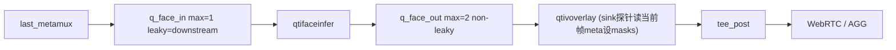

# 人脸内联恢复 + qtifaceinfer 生命周期加固（专家审核修订版）

审核结论：方向正确，本版并入专家 9 条修正。用户决策：**不做卡死自动拉起**（卡死即退出/停住，人工处理），故删除 supervisor/watchdog 自动恢复项。

## 结论与根因（按专家表述修订）

- 严格「帧↔白框同帧同步」只能靠**内联主链路**：overlay sink 探针读**当前 buffer 自己**的 `GstFaceDetectionMeta`，`camera_id/frame_id/PTS/图像`天然一致。旁路 + `map<camera_id,masks>` 只能做到「同摄像头最近一次」，人脸移动必拖影/错位、停滞旧框残留 —— **不采用 face-mask-percam-fix**。
- 根因表述：**dma-buf/OpenCL 导入对象管理是当前强根因候选**；旁路运行数据证明缓存修复有效（板端 1h35m：cache 38/21、fd/CMA/RSS 平稳、bad_alloc=0），**但 inline 版本尚未完成长稳验证**。已确认的结构性事实是：**只要同步 `ProcessFrame` 阻塞，queue/leaky 无法越过该帧，整条直播主路会停**。
- 因此内联必须具备：保留缓存修复 + fail-closed 异常边界。**卡死不做自动恢复**（用户决策）：若 `ProcessFrame` 真卡死，接受主路停住，人工重启。

## 目标拓扑（内联）



## 改动一：有条件回退内联拓扑 + 保留 mask 修复 + 收紧队列

文件：[src/pipeline/GstPipelineBuilder.cpp](src/pipeline/GstPipelineBuilder.cpp)

1. **不无条件 checkout**：先 `git --no-pager diff HEAD -- src/pipeline/GstPipelineBuilder.cpp` 确认该文件改动只含旁路相关（FaceMaskStore/探针/`#include <string>`），无其它需保留的用户修改；确认后再 `git checkout HEAD -- src/pipeline/GstPipelineBuilder.cpp` 恢复内联结构（`q_face_in→faceinfer→q_face_out→overlay→tee_post` + overlay sink 内联 lambda）。
2. **保留分隔符修复**：HEAD 的内联 lambda 用 `if (i > 0) s += ','`，当跳过无效框（`w<=0||h<=0` continue）时会生成**错误 masks 字符串**。改为旁路里已修好的写法：用 `guint written` 计数，`if (written > 0) s += ','; ...; ++written;`。
3. 队列参数：
   - `q_face_in`：`ConfigureBoundedQueue(q_face_in, 1, 2)`（max-buffers=1，leaky=downstream）。
   - `q_face_out`：`ConfigureBoundedQueue(q_face_out, 2, 0)`（max-buffers=2，non-leaky；让 overlay 背压回传到入口再丢，不浪费已完成推理）。
4. overlay 继续读当前 buffer 自带 meta，无 meta 时 `masks="{  }"`；**不引入任何跨支路 store**。

## 改动二：transform_ip 异常边界（fail-closed，禁止 fail-open）

文件：[plugins/qtifaceinfer/gst_plugin/gstfaceinfer.cpp](plugins/qtifaceinfer/gst_plugin/gstfaceinfer.cpp)

- `gst_face_infer_transform_ip` **整段函数体**包 `try{...}catch(const std::bad_alloc&){}catch(const std::exception&){}catch(...){}`。
- **禁止**在 catch 后 `return GST_FLOW_OK`——那会把**没有人脸 meta 的原始帧**送进直播 = 隐私 fail-open。
- 策略（fail-closed，本轮采用）：catch 到 `bad_alloc`/`std::exception`/未知异常时，`GST_ELEMENT_ERROR(self, STREAM, FAILED, ...)`（向 bus 发 error）+ `return GST_FLOW_ERROR`。`main.cpp` 的 `WebrtcRunBusWatch` 收到 `GST_MESSAGE_ERROR` 即 `terminal_bus_message=true; exit_reason=kBusError` → **干净的受监管退出（不再 terminate 崩溃）**，见 [main.cpp](main.cpp) L419-420。
- **退出后不自动重启**（用户决策）：进程停住，人工重启。相比现状（`std::bad_alloc` 直接 terminate）已是改善，且**不泄漏未遮挡人脸**。
- 备选（本轮不采用）：异常时对该帧做整帧遮挡以保活主路，但会引入额外复杂度。
- 异常穿越 GStreamer C ABI 绝对禁止（会 `std::terminate`）。

## 改动三：缓存身份完整校验（防 fd 复用到不同 dma-buf）

文件：同上。`#include <sys/stat.h>`；`_GstFaceInferPrivate` 增 `guint64 caps_generation = 0;`，`set_caps` 每次自增。

- `CachedImport` 记 `ino_t st_ino; off_t st_size; guint64 caps_gen;`。
- 命中路径先 `fstat(fd,&st)`：仅当 `st.st_ino==entry.st_ino && st.st_size==entry.st_size && entry.caps_gen==priv->caps_generation` 才复用；**`fstat` 失败一律按 miss** 处理（不复用）。
- 失配 → 驱逐旧条目（在锁外 RAII 释放旧 cl_mem，见改动四）+ 走 miss 重新导入。
- `set_caps` 变更时 `flush_fd_cache()` 保留作双保险。

## 改动四：CachedImport move-only RAII + 无锁释放 + 硬上限受控失败

文件：同上。`CachedImport` 需满足：

- **copy deleted**；**move ctor/assignment `noexcept`**；**destructor `noexcept`**。
- 持有**稳定的** `std::shared_ptr<face_infer::OpenClLoader>`（`OpenClLoader::Get()` 即返回 shared_ptr）或自定义 deleter，使析构释放不依赖可能已销毁的全局单例。
- `clCreateBuffer` 成功后**立即**放入局部 RAII 变量；即便后续 map 插入抛异常或提前返回，也保证释放。
- 入 map 用 `emplace` / `insert_or_assign` + `std::move`。
- **不在 cache mutex 内调用 OpenCL `ReleaseMemObject`**：驱逐/flush 时先在持锁状态把条目 `std::move` 到局部容器，**解锁后**再让其析构释放。
- **避免持锁再调 `flush_fd_cache`**（防重入死锁）。
- `flush_fd_cache()`：持锁把整个 map swap 到局部，解锁后析构释放；记录计数日志。
- `stop()` 顺序不变：**先 flush_fd_cache（释放全部 cl_mem，context 仍有效），再 `processor->Destroy()`**；`finalize()` 时 map 已空。
- 硬上限 `#define FACE_CACHE_HARD_MAX 128`：miss 插入新 fd 前若 `size>=128`，**记录 hard-cap trip 并限频告警**；**反复触发时做受控失败**（`GST_ELEMENT_ERROR`+`GST_FLOW_ERROR` → 受监管退出，不自动重启），**不得无限 flush/reimport**（正常池 38/21，128 远高于正常值，触顶即异常信号）。

## 改动五：face 心跳（仅诊断，不做自动恢复）

文件：同上。

- `transform_ip` 末尾按墙钟每 ~5s 打印 `[faceinfer] hb fps=.. frames=.. cache=.. import=.. hit=.. err=..`，仅供运维观测 face 是否停摆。
- **不做自动拉起/看门狗**（用户决策：卡死即卡死）。**诚实声明**：现有 `encoder circuit-breaker` 不是通用 face watchdog——它仅检查有 READY WebRTC 会话的编码器、encoder build 期间跳过，且 face 心跳无独立消费者；因此不宣称能自动恢复卡死。若 inline `ProcessFrame` 真卡死，主路停住需人工重启。

## 构建 / 部署 / 校验（位置与方法修正）

1. 重编：主程序 `cmake --build build_unified -j4 --target aibox_stream_pipeline_demo`；插件 `cd plugins/qtifaceinfer && cmake --build build_board -j4`。
2. **部署位置分离**（勿都放 runtime_plugins）：
   - executable → 板端 `build_unified/aibox_stream_pipeline_demo`；
   - plugin → 板端 `runtime_plugins/libgstqtifaceinfer.so`（`GST_PLUGIN_PATH=$R/runtime_plugins`）。
3. **加载校验**：`grep -F libgstqtifaceinfer.so /proc/<pid>/maps`（`/proc/<pid>/maps` 不是符号链接，**不要用 readlink**）确认加载的是 `runtime_plugins/` 那份（板上 `/usr/lib` 有同名副本，`gst-inspect` 不可信）。
4. **分别核对 SHA256**：executable 与 plugin 各自 `sha256sum` 与工作区一致。确认启动日志 `[face] enabled=1` 且**非 SIDE branch**。

## 验收（10 分钟 6 路）

- 每分钟记录：每路 raw/enc/parsed、face frames、fd、RSS/PSS、CmaFree、cache size/import/hit、mmap/cl/QNN 错误。
- cache size 快速收敛后不变；fd/RSS/CMA 不漂移。
- **同步验证**：在 `qtifaceinfer.src` 与 `qtivoverlay.sink` 两处采样比较 `(camera_id, frame_id, PTS)` 相等；**不要求 `GstBuffer` 指针相同**（临时调试日志，验收后移除）。
- 六路分别快速移动人脸：白框不串摄像头、不拖影、不用历史坐标。
- 做 `SIGTERM→NULL→重启` 循环，验证缓存释放顺序、QNN/OpenCL teardown。
- 若内联仍偶发 `ProcessFrame` 卡死：本轮接受主路停住（不自动恢复）；后续若要恢复，再评估旁路 +（camera_id,frame_id）bounded join 或独立 face-output watchdog。

## 一键复制总结（交执行者）

```
目标：放弃旁路(face-mask-percam-fix)，回退 4f3f554 内联主链路 + 加固 qtifaceinfer 生命周期。同帧同步靠 overlay 读当前 buffer 自带 GstFaceDetectionMeta，不用任何跨支路 store。不做卡死自动拉起。

A. src/pipeline/GstPipelineBuilder.cpp
   1) 先 git --no-pager diff HEAD -- 该文件，确认只含旁路改动无需保留其它；再 git checkout HEAD -- src/pipeline/GstPipelineBuilder.cpp 回退内联。
   2) 保留 mask 修复：把内联 lambda 的 if(i>0) 改成 guint written 计数(if(written>0)+ ++written)，避免跳过无效框时生成错误 masks 串。
   3) q_face_in  = ConfigureBoundedQueue(q_face_in, 1, 2)  (max=1, leaky=downstream)
      q_face_out = ConfigureBoundedQueue(q_face_out, 2, 0) (max=2, non-leaky)

B. plugins/qtifaceinfer/gst_plugin/gstfaceinfer.cpp
   4) transform_ip 整段 try/catch(bad_alloc/exception/...)：禁止 return GST_FLOW_OK(fail-open)。
      catch -> GST_ELEMENT_ERROR(STREAM,FAILED)+return GST_FLOW_ERROR -> bus error -> 干净受监管退出(不 terminate)。退出后不自动重启。
   5) #include <sys/stat.h>；priv 加 caps_generation(set_caps 自增)。CachedImport 记 st_ino/st_size/caps_gen；
      命中前 fstat 全等才复用，fstat 失败=miss，失配=驱逐+重导入。
   6) CachedImport: copy删; move+dtor noexcept; 持 shared_ptr<OpenClLoader>; clCreateBuffer 后立刻入局部 RAII;
      insert_or_assign+move 入 map; ReleaseMemObject 一律在 cache 锁外(先移出再析构); 不持锁调 flush;
      stop() 先 flush 再 Destroy。
   7) FACE_CACHE_HARD_MAX=128：触顶记录+限频告警；反复触发做受控失败(ELEMENT_ERROR+FLOW_ERROR 退出)，不无限 flush/reimport。
   8) transform_ip 末尾每~5s 打印 [faceinfer] hb fps/frames/cache/import/hit/err(仅诊断)。不做看门狗/自动拉起。

C. 构建部署校验
   9) cmake --build build_unified -j4 --target aibox_stream_pipeline_demo；cd plugins/qtifaceinfer && cmake --build build_board -j4
   10) executable -> 板端 build_unified/aibox_stream_pipeline_demo；plugin -> 板端 runtime_plugins/libgstqtifaceinfer.so(勿都放 runtime_plugins)。
   11) grep -F libgstqtifaceinfer.so /proc/<pid>/maps 确认加载 runtime_plugins 那份(勿 readlink)；executable 与 plugin 分别核对 sha256；[face] enabled=1 且非 SIDE branch。

D. 验收：6 路 10min；每分钟记 raw/enc/parsed、face frames、fd、RSS/CMA、cache size/import/hit、mmap/cl/QNN 错误；
   cache 收敛不漂移；在 qtifaceinfer.src 与 qtivoverlay.sink 比较 (camera_id,frame_id,PTS) 相等(不比 GstBuffer 指针)；
   快速移动人脸白框不串/不拖影；SIGTERM 循环验证 teardown。

不改：检测语义(每帧检测/best-effort)、编排表结构、GstFaceDetectionMeta。回退开关：[face] enabled=0。
本轮不处理：Close All→Start All 的 circuit-breaker 退出 + bad_alloc(独立会话重建老问题)；卡死自动恢复(用户明确不做)。
```
