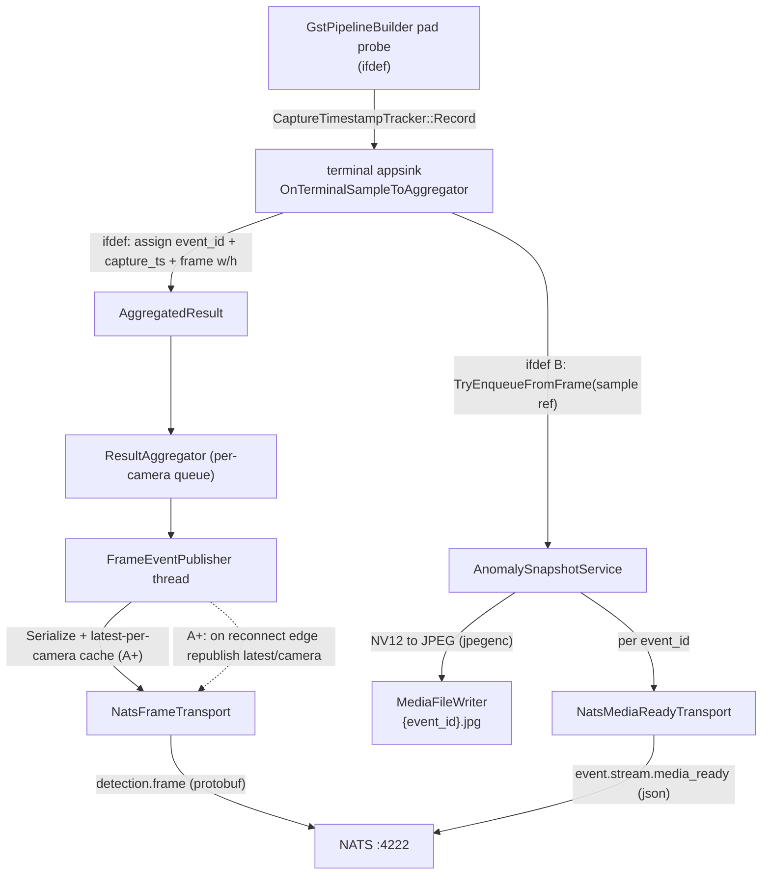

# IoT_pipeline0820 两个功能迁移与验收方案(按序 A → A+ → B)

## 目标与约束(已定稿)

- 迁移功能 A(IR-DATA-001):Aggregator → Protobuf `FrameEvent` → NATS `detection.frame`。
- 迁移功能 B(IR-DATA-002):异常帧 JPEG 落盘 + `event.stream.media_ready`(五字段 JSON,复用 A 的 `event_id`)。B 依赖 A,故在 A 之后。
- 额外新增:latest-per-camera 断连缓存 + 重连补发(0814 未做项),作为 A 的增量阶段 A+。
- 验收路径:完全复刻 0814 —— WebRTC OFF + `config_snapshots/demo_2stage_yolo_serial/pipeline_1cam.txt`(1 路 YOLO26)。
- 0820 目录**完全独立**:所有自定义组件(proto、runtime_plugins、plugins/ml_modules、测试、脚本)物理复制进 0820,**禁止**软链或引用 0814/0817 路径;脚本内硬编码 ROOT 全部改成 `/mnt/workspace/8_20/IoT_pipeline0820`。
- 开发流程:本地改码 → `scp` 到板端 `/mnt/workspace/8_20/IoT_pipeline0820` → 板端 `build_events` 编译 → 板端 `ctest` + 实况 E2E。
- 依赖:自定义 gst 插件用预构建 `.so` 复制方式提供;`libnats`/`protobuf`/`libuuid`/`jpegenc` 视为板端已装(与 0814 同板)。
- 回退基线:`eb4bef0`(测试完 batch 备份)。每阶段一个提交,可按阶段回退。

## 两处加固(本次评审新增)

- 加固 1 —— appsink 新逻辑全部门控:0814 把 `event_id` 赋值放在 `HAVE_DETECTION_NATS` 之外(永远生成)。0820 默认关闭该功能且热路径是 16 路 batched 高帧率,故本方案把 appsink 里新增的 `event_id` 赋值、采集时戳 Take、frame 尺寸读取、snapshot 入队,以及 [GstPipelineBuilder](src/pipeline/GstPipelineBuilder.cpp) 的采集 probe **统统包进 `#ifdef HAVE_DETECTION_NATS`**;`Uuid.cpp`/`CaptureTimestampTracker.cpp` 也仅在 `ENABLE_DETECTION_NATS` 下参与编译。默认/性能/WebRTC 构建的 `MAIN_SOURCES` 与运行行为**逐字节不变**。(相对 0814 的有意偏离,理由:保护刚备份的 batch/fps 性能基线。)
- 加固 2 —— NatsAdapter 合并而非覆盖:0820 已有一个服务 WebRTC 信令的 [NatsAdapter](include/aibox/adapter/NatsAdapter.hpp)。阶段 A 第一步先 diff 两版,**取功能超集**(补 data-plane 需要的 `Publish` 二进制、`GetState`、重连回调、`max_pending`),保持 `webrtc.cam.*` 信令语义不变,全工程**只保留一份** NatsAdapter,不产生双实现。

## 现状差异(为何要迁移)

- 0820 [CMakeLists.txt](CMakeLists.txt) 只有 `ENABLE_WEBRTC`(默认 OFF),NATS 仅服务 WebRTC 信令;**无** `ENABLE_DETECTION_NATS`、无 proto、无 `imsdk_proto`。
- 0820 [include/aibox/aggregator/Result.hpp](include/aibox/aggregator/Result.hpp) 的 `Detection` **无 `event_id`**;`AggregatedResult` **无** `capture_timestamp_ms`/`frame_width`/`frame_height`。
- 0820 [src/pipeline/AppSinkCallbacks.cpp](src/pipeline/AppSinkCallbacks.cpp) 的 `OnTerminalSampleToAggregator` 不赋 `event_id`、不接线 snapshot。
- 0820 [main.cpp](main.cpp) 检测结果走 `JsonFileEventSink`(`./output/events.jsonl`),无 `--media-dir`、无 detection NATS 接线。
- 0820 无 `test/aggregator_nats`、`test/media_snapshot`、无 `src/detection/*`、无 `src/media/*`、无 `contracts/`。

## 数据流(全部迁移后,WebRTC OFF)

---

# 阶段 A —— IR-DATA-001 `detection.frame`(独立验收 + 提交)

## A0 NatsAdapter diff 合并(加固 2)

- diff [include/aibox/adapter/NatsAdapter.hpp](include/aibox/adapter/NatsAdapter.hpp)/`src/adapter/NatsAdapter.cpp` 与 0814 版本。
- 取超集:确保存在 `Publish(subject, vector<uint8_t>)`、`GetState()`、`OnReconnected`/`OnDisconnected` 回调、`Config.max_pending`;保留 WebRTC 侧现有行为与 `webrtc.cam.*` 语义。
- 结论:全工程单一 NatsAdapter 实现;WebRTC 与 detection 各持独立实例(验收 WebRTC OFF,不同时连,冲突面最低)。

## A1 复制功能 A 源码 + Result 结构

- 复制 proto:`contracts/imsdk/1.0/aibox_contracts.proto` → 0820 同路径。
- 复制:`src/detection/{Uuid,CaptureTimestampTracker,FrameEventBuilder,FrameEventPublisher,NatsFrameTransport}.cpp` 及 `include/aibox/detection/*.hpp`(含 `IFrameTransport.hpp`)。
- [include/aibox/aggregator/Result.hpp](include/aibox/aggregator/Result.hpp):`Detection` 加 `std::string event_id;`;`AggregatedResult` 加 `uint64_t capture_timestamp_ms=0; uint32_t frame_width=0; uint32_t frame_height=0;`(纯新增字段,兼容既有读取)。

## A2 appsink 接线(加固 1:全部 ifdef)

- [src/pipeline/AppSinkCallbacks.cpp](src/pipeline/AppSinkCallbacks.cpp) `OnTerminalSampleToAggregator`,新增逻辑整体包进 `#ifdef HAVE_DETECTION_NATS`:
  - 每个 Detection `det.event_id = aibox::detection::UuidV4();`(唯一赋值点)。
  - 从 sample caps 取 `frame_width/height`(`gst_video_info_from_caps`)。
  - `capture_timestamp_ms` 走 `CaptureTimestampTracker::GetProcessInstance()->Take(camera_id, frame_id)`,miss 回退 now。
  - 保留现有 ROI overflow 早退分支(不入队、不 Submit)。
- [src/pipeline/GstPipelineBuilder.cpp](src/pipeline/GstPipelineBuilder.cpp):迁移 0814 采集时刻 pad probe(`CaptureTimestampTracker::Record`,记 Unix ms,不改插件 ABI),同样 `#ifdef HAVE_DETECTION_NATS` 门控。
- 默认(无 `HAVE_DETECTION_NATS`)构建:该回调与 probe 与现状完全一致。

## A3 main.cpp 接线(A)

- [main.cpp](main.cpp) 在 `run_seconds>0 || run_forever` 分支内,`#ifdef HAVE_DETECTION_NATS` 用 detection NATS 路径**替代**旧 `JsonFileEventSink`+`DetectionEventPublisher`:
  - 构造 `detection_nats`(默认 `nats://127.0.0.1:4222`,`AIBOX_DETECTION_NATS_URL` 可覆盖),Connect 失败 → pipeline NULL + **退出码 23**。
  - `NatsFrameTransport` + `FrameEventPublisher`(接 `g_aggregator`)`Start()`。
  - `#else` 保留旧 JSONL 路径,保证现有 fps/noweb 流程不变。
- 停止顺序(严格):pipeline→NULL → `publisher.Stop()` → `detection_nats.Disconnect()` → 打印计数 → `NatsAdapter::CloseLibraryAndWait()` → `CaptureTimestampTracker::SetProcessInstance(nullptr)`。(B 阶段再在此序列插入 snapshot 服务的 Stop/清单例。)

## A4 CMake + 复制 test/aggregator_nats

- [CMakeLists.txt](CMakeLists.txt):
  - 加 `option(ENABLE_DETECTION_NATS "..." OFF)`(默认 **OFF**,保现有 `build/` 与 WebRTC 构建不变;验收用独立 `build_events` 显式 `-DENABLE_DETECTION_NATS=ON`)。
  - `if(ENABLE_WEBRTC OR ENABLE_DETECTION_NATS) pkg_check_modules(NATS REQUIRED libnats)`。
  - `if(ENABLE_DETECTION_NATS)`:`find_package(Protobuf)` + `protobuf_generate_cpp` + `add_library(imsdk_proto STATIC ...)`;`MAIN_SOURCES` 追加 `src/detection/*`(含 `Uuid.cpp`、`CaptureTimestampTracker.cpp`,**仅此门控下编译**——加固 1)+ `NatsAdapter.cpp`(与 WebRTC 分支去重);`MAIN_LIBS` 追加 `${NATS_LIBRARIES} imsdk_proto`;`target_compile_definitions(... HAVE_DETECTION_NATS=1)`;include 加 `${CMAKE_CURRENT_BINARY_DIR}`。
  - `include(CTest)` + `if(BUILD_TESTING AND ENABLE_DETECTION_NATS) add_subdirectory(test/aggregator_nats) endif()`;保留现有 `test_batch_planning` 等 batch 目标不动。
- 复制 `test/aggregator_nats/`(含 `integration/IsolatedNats.hpp` 副本、`unit/`、`scripts/run_integration.sh`、`CMakeLists.txt`、`README.md`);改脚本硬编码 ROOT 为 `/mnt/workspace/8_20/IoT_pipeline0820`,snapshot 指向 `demo_2stage_yolo_serial/pipeline_1cam.txt`。隔离端口 14223/14224,不碰 4222。

## A5 阶段 A 验收 + 提交

- 板端:`export GST_PLUGIN_PATH="$PWD/runtime_plugins"; export GST_REGISTRY_UPDATE=1`;`cmake -S . -B build_events -DCMAKE_BUILD_TYPE=RelWithDebInfo -DENABLE_WEBRTC=OFF -DENABLE_DETECTION_NATS=ON -DBUILD_TESTING=ON`;`cmake --build build_events -j4`。
- `ctest --test-dir build_events -R aggregator_nats --output-on-failure`(contract + integration + nfr,全绿)。
- 1 路实况:先起 `frame_event_subscriber --url nats://127.0.0.1:4222 --seconds 35 --min-detections 1 --expected-camera-id cam-001 --frame-width 1920 --frame-height 1080`,再 `aibox_stream_pipeline_demo --snapshot .../pipeline_1cam.txt --run-seconds 25`。断言主程序 `published>0 build_failures=0 publish_failures=0`;订阅侧 `uuid_invalid=0 uuid_duplicate=0 confidence_oob=0 bbox_invalid=0 camera_empty=0 timestamp_regress=0`,含空帧(AC-4)。
- 对照 imsdk 清单 AC-1..AC-7 / NFR-1..4 产出 `IR-DATA-001` 验收记录 md(写入 0820 工程内文档目录);系统 4222 未重启。
- 单独提交(阶段 A)。

---

# 阶段 A+ —— latest-per-camera 重连补发(A 的增量,独立验收 + 提交)

## A+1 实现

- [src/detection/FrameEventPublisher.cpp](src/detection/FrameEventPublisher.cpp):
  - 加 `std::unordered_map<std::string, std::vector<uint8_t>> latest_by_camera_`(每次 `Serialize` 成功后按 `result.camera_id` 覆盖最新 payload)。
  - `Run()` 循环查连接态(`IFrameTransport` 新增 `bool IsConnected()`,`NatsFrameTransport` 转发 `NatsAdapter::GetState()==kConnected`)。`saw_disconnect_` 记跌落沿;检测到 `断开→连上` 上升沿时遍历缓存逐路 `PublishFrame` 补发,计数 `republished_`。补发在 publisher 线程执行(非 NATS 回调线程)。

## A+2/A+3 验收 + 提交

- 扩展 [test/aggregator_nats/integration/nfr_reconnect_tests.cpp](test/aggregator_nats/integration/nfr_reconnect_tests.cpp)(14224):cam-001/cam-002 各发若干帧 → 停隔离 server → 重启 → 断言重连后**每路各收到一条最新补发**且字段合法。
- 板端 `ctest -R aggregator_nats` 含新单测全绿;实况短暂断开/恢复 4222 验证每路补发。
- 更新 `IR-DATA-001` 记录 md(补重连补发一节);单独提交(阶段 A+)。

---

# 阶段 B —— IR-DATA-002 异常帧存图(依赖 A,独立验收 + 提交)

## B1 复制功能 B 源码 + 板端插件

- 复制:`src/media/{SnapshotEncoder,MediaFileWriter,NatsMediaReadyTransport,SnapshotTriggerPolicy,AnomalySnapshotService}.cpp` 及 `include/aibox/media/*.hpp`(含无 .cpp 的 `MediaReadyEvent.hpp`、`IMediaReadyTransport.hpp`)。
- 板端复制 `runtime_plugins/libgst*.so`、`plugins/ml_modules/libml-postprocess-*.so` 进 0820 树;`gst-inspect-1.0 aiboxtimemux`/`jpegenc` 前置确认。

## B2 接线(appsink + main + CMake + test)

- [src/pipeline/AppSinkCallbacks.cpp](src/pipeline/AppSinkCallbacks.cpp):在 A2 已建立的 `#ifdef HAVE_DETECTION_NATS` 块内、`agg->Submit(std::move(res))` **之前**,若 `AnomalySnapshotService::GetProcessInstance()` 非空则 `TryEnqueueFromFrame(camera_id, capture_ts, res.detections, now_mono_ms, sample)`(服务内部 `gst_sample_ref`)。
- [main.cpp](main.cpp):`ResolveMediaDir(args.media_dir)`(`--media-dir` → `AIBOX_MEDIA_DIR` → `$CWD/media`,`realpath`);构造 `MediaFileWriter`+`GstSnapshotEncoder`+`NatsMediaReadyTransport`+`AnomalySnapshotService`,`SetProcessInstance(&svc)` 后 `Start()`,**PLAYING 之前**。CLI 加 `--media-dir`、`--min-detections`。停止顺序在 A3 基础上插入:pipeline→NULL 后 `svc.Stop()` → `SetProcessInstance(nullptr)`,再走 publisher/Disconnect。
- [CMakeLists.txt](CMakeLists.txt):`ENABLE_DETECTION_NATS` 块内 `MAIN_SOURCES` 追加 `src/media/*`;`add_subdirectory(test/media_snapshot)` 加入门控。
- 复制 `test/media_snapshot/`(含 `integration/IsolatedNats.hpp` 副本、`unit/`、`scripts/run_e2e_live.sh`、`run_e2e_writefail.sh`、`CMakeLists.txt`);改脚本硬编码 ROOT 为 0820、snapshot 指向 `pipeline_1cam.txt`。隔离端口 14225。

## B3 阶段 B 验收 + 提交

- 板端 `cmake --build build_events -j4` + `ctest --test-dir build_events -R 'media_snapshot|aggregator_nats' --output-on-failure`(全绿,含 A/A+ 回归)。
- 实况成功路径:`bash test/media_snapshot/scripts/run_e2e_live.sh 40`。断言磁盘 JPEG `FFD8/FFD9`;`jpeg_count>=1 && jpeg_count<=run_seconds+camera_count`;`ready_msgs>=jpeg_count && ready_msgs<detection_frames`;`ready_id_unknown=0`。
- 实况写失败路径:`bash test/media_snapshot/scripts/run_e2e_writefail.sh 10`(临时目录 `chmod a-w`,teardown 恢复删除)。断言 `written_ok=0 write_failures>0 published=0 ready_msgs=0`。
- 产出 `IR-DATA-002` 验收记录 md;明确记「未触发帧有 event_id 无 media_ready 是 on_change 预期」、CTest 与实况分开记、系统 4222 未重启。单独提交(阶段 B)。

---

## 明确未做(沿用 0814,除已加的重连补发)

- 9 路 / 8 小时 soak、ASan/UBSan/TSan。
- `DetectionNatsFatal` 细分(退出码 23 已实现)。
- 短视频 / pre-roll / media-upload / Rule Engine / 改 FrameEvent proto / 碰 WebRTC 树。
- 与真实 AIBox `cameras` 表比对(AC-7 用 `cam-001` 代理)。

## 风险与回退

- NatsAdapter 双版本差异 → A0 先 diff 合并,单一实现(加固 2)。
- 默认开启会让无 NATS 的 fps/noweb 触发退出码 23 → `ENABLE_DETECTION_NATS` 默认 **OFF**,仅 `build_events` 显式开启;appsink 新逻辑全 ifdef(加固 1)。
- batched(b2/b4/b16)下 appsink 同一入口,event_id/enqueue 不受 batch 影响;验收用 1 路 serial,风险最低。
- DMA-BUF 抽干:先拷系统内存 NV12 再 unref + 队列深 1–2(沿用 0814)。
- 回退:基线 `eb4bef0`;A / A+ / B 各一提交,可按阶段 `git reset` 回退。
