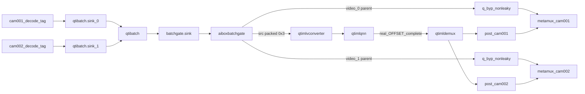

# Phase 3 改为 post-qtibatch batch-level gate

批准后的**第一件事**：把本方案完整写入权威计划 [`.cursor/plans/b2_ppyoloe_embedding_bbd2559f.plan.md`](.cursor/plans/b2_ppyoloe_embedding_bbd2559f.plan.md)，并废止该文件中已过时条款（入口 credit gate、Stage1 tee 前 gate、Phase 3「gate→tee→qtibatch」、Phase 4「Stage2 不插 gate / 只在 S2 还入口 credit」）。Phase 0–2.5 已完成结论保留。本回合只落计划，不改代码。

## 根因（官方源码，不再猜测）

`qtibatch` 每次建输出先 `GST_BUFFER_OFFSET=0`，再按实际取到的 sink 置位 `(1<<stream_id)`。因此：

- `0x3` = 完整 B2，才能进固定 `batch=2` 的 QNN
- `0x1` / `0x2` = 官方允许的 **partial output**，不是完整 B2 后的 per-slot view，**禁止进 QNN**
- 等待用的是持续推进的绝对 `endtime`，不是每次从现在重算。超时且任一路 `queue >= depth` 就出 partial，并从该 sink queue 删帧

当前错误结构：`decode → 入口 credit gate → tee → qtibatch → QNN`。QNN 期间 gate 停送，`endtime` 过期；第二次顺序 `push sink_0` 再 `push sink_1` 被拆成 `0x1` 然后 `0x2`。probe DROP 后 QNN 无输出 → `inflight=1` 永不还 credit → 全是 `drop_overload`。与 `output/b2_pp-yolo_phase3_20260817_150249/demo.log` 一致。

`moving-window-size=1` 不是根因。禁止用 rateadapt / `frequency>0` / 改官方 qtibatch / 调 window / flush 重启 qtibatch 掩盖。

## 必须废止的旧决策

权威计划里下列句子作废，不得再当实现依据：

- 「gate 必须在 Stage1 两个 tee 之前」
- 「用 credit gate 暂停 qtibatch 输入直到 QNN 完成」
- 「Stage2 不插第二个 gate，只在 Stage2 qnn.src 还入口 credit」
- 「一个 BATCH_PARTIAL 立即 `GST_ELEMENT_ERROR`」
- [`OnBatchSrcProbe`](src/pipeline/GstPipelineBuilder.cpp) 把 `OFFSET_NONE` 当完整 B2 放行
- [`OnQnnCompleteBatchProbe`](src/pipeline/GstPipelineBuilder.cpp) 忽略 buffer、固定 `complete-batch(0x3, TRUE)`
- [`run_phase3_noweb.sh`](test/b2_pp-yolo/run_phase3_noweb.sh) 以「出现一次 complete-batch」为通过

## 目标拓扑（单级，Phase 3-R3）

要点：

- 两路 decode **持续**送 `qtibatch.sink_N`，不因 QNN credit 暂停
- gate 在 `qtibatch.src`：只对完整 packed B2 做有界准入
- `0x1/0x2`：`drop_partial++`，不耗 credit，不进 QNN，不进 bypass
- `0x3 && credit==1`：校验 2 个 `GstParentBufferMeta` + FrameMeta 后同时推出 packed `src` 与 `video_0`/`video_1`
- `0x3 && credit==0`：最多保留 **一份** 最新 pending，替换旧 pending 并 `drop_overload++`
- QNN：`qtimlqnn.sink` 与 `.src` 都校验真实 OFFSET==0x3 且 tensor batch==2 后，才 `complete-batch(real_mask, true)`；有 pending 则立即准入最新一份
- bypass 映射只信 `FrameMeta.batch_stream_id`（0→video_0，1→video_1），禁止按 parent 遍历顺序猜 camera
- `video_N` 发 mono caps + sticky（stream-start→caps→segment）；packed `src` 透传 batch caps；mono caps 来自 R0 验证后的 `group.input_caps`
- admit 先推 `video_0/1` 再推 packed `src`；任一路失败则 ERROR、不伪造 credit；sink 对 qtibatch 始终 `GST_FLOW_OK`
- `q_byp` 仍 non-leaky；不插 `aiboxrateadapt`
- 只改 B2 分派分支；B1 / YOLO26 / time-mux / `src/webrtc/*` 禁止动；R4 前必须先过 legacy 回归

## aiboxbatchgate 新契约

现插件是 per-stream request pad（`sink_%u`/`src_%u`），见 [`gstaiboxbatchgate.h`](plugins/aiboxbatchgate/gstaiboxbatchgate.h) 与 [`test/batch/test_aiboxbatchgate.cpp`](test/batch/test_aiboxbatchgate.cpp)。R2 **重做 pad 与状态机**，保留唯一 GType 名 `GstAiboxBatchGate` / factory `aiboxbatchgate`（0.3 零侵入仍有效）。

新 pad：

- `sink` always：接 `qtibatch.src`
- `src` always：只出获准的完整 packed B2
- `video_0` / `video_1` request：对应 parent 原始帧

状态：`credit`、`inflight`、`pending_full_batch`（最多 1）、`admitted_batches`、`completed_batches`、`drop_overload`、`drop_partial`、`invalid_batch`。

准入还须：`OFFSET==0x3`、parent meta 数==2、两路 `batch_stream_id` 为 0 和 1、`camera_id` 正确且不重复、size/`n_memory` 与完整 B2 约定一致。失败：`invalid_batch++`，拒绝，不伪造 credit。

`gst_pad_push` **不得持 lock**。`complete-batch` 只校验+计数+唤醒；由独立 `GThread` 推 pending（与现 gate 调度方式一致）。

连续 partial 超阈值或一路长期进不了 full batch → group degraded/`GST_ELEMENT_ERROR`。单个 partial **不得**杀死 pipeline。

R2 **可以**开始设计和单元测试。**进入 R3 Builder 前**，下列五围栏必须已写入本计划且 R0 映射证明成立；缺任一项不得改生产 Builder。

## 五围栏（R3 Builder 阻塞门槛）

### 围栏 1 — `video_0`/`video_1` 的 caps 与 sticky-event

这是当前最大遗漏。`batchgate.src` 可透传 `qtibatch.src` 的 packed/multiview caps；`video_0`/`video_1` 输出的是 `GstParentBufferMeta` 取回的**原始单路 buffer**，**不得**把 qtibatch 的 separated/multiview caps 原样发给它们。

R2 必须写死：

- `batchgate.sink`：接收 qtibatch 的 packed / separated video caps
- `batchgate.src`：原样转发该 packed caps 给 converter/QNN
- `batchgate.video_0`/`video_1`：发送对应单路 **mono video caps**；第一帧前按 `stream-start → caps → segment` 发送 sticky event

R0 必须先验证原始 parent buffer 的实际 caps 与 segment 语义。Builder 将已验证的 `group.input_caps` 注入 gate，作为各 `video_N` 的 mono caps 来源；**不得猜测，不得复用 batch caps**。未完成则 `qtimetamux` 可能 caps 不协商、PTS 不匹配或中断。

### 围栏 2 — 一次 admit 的三路输出原子失败

一份完整 B2 准入时输出三条流：`packed src` → converter/QNN；`video_0` → cam-001 metamux；`video_1` → cam-002 metamux。

顺序与失败规则：

1. 锁内只做 credit/inflight 切换并取得 buffer 引用
2. 解锁
3. 先向 `video_0`/`video_1` 的独立 queue 推 parent buffer
4. 再向 packed `src` 推 B2 wrapper
5. 任一 `push` 非 `GST_FLOW_OK`：立即 `GST_ELEMENT_ERROR`；禁止继续下一组；禁止归还伪造 credit

避免 QNN 已出 ROI 而一路 bypass 视频未到。

gate 的 sink chain 在 busy 或 pending 满时必须自行 `unref`/drop 后返回 **`GST_FLOW_OK`**，不得把阻塞或错误回传给 `qtibatch`（否则重建内部积压）。

### 围栏 3 — Parent 所有权与映射（硬性）

映射：不依赖 parent meta 遍历顺序，只读 `FrameMeta.batch_stream_id`（0→`video_0`，1→`video_1`）。

所有权：

- wrapper 上的 `GstParentBufferMeta` 仍拥有 parent 引用
- `video_N` 输出只做 `gst_buffer_ref(parent)`
- `pending_full_batch` 持有 wrapper 的**唯一额外**引用
- 替换 pending、FLUSH、EOS、NULL、异常退出必须 `unref` wrapper
- wrapper 释放后由 ParentBufferMeta 自动归还 parent
- **不得** copy/mutate packed wrapper 的 OFFSET、ProtectionMeta、ParentBufferMeta

R0 必须先证明：`mask=0x3` → parent meta 数恰为 2 → 两个 parent 都带 AiboxFrameMeta → `stream_id` 为 0/1 且 `camera_id` 不重复 → parent PTS 与 qtibatch sink 输入对应。不成立则**停止**，改「per-camera PTS cache + admission 通知」，**不得进入 R2 生产实现 / R3**。

### 围栏 4 — QNN 检查点含 `qtimlqnn.sink`

R3 链路：`batchgate.src → converter → qtimlqnn.sink probe → qtimlqnn.src probe`。

必须同时验证：

- `qtimlqnn.sink`：真实 OFFSET `== 0x3`，输入 tensor batch `== 2`
- `qtimlqnn.src`：真实 OFFSET `== 0x3`，输出 tensor batch `== 2`

官方 QNN 会复制输入 OFFSET；若 converter 丢掉 batch/protection，只查 src 会太晚。

**删除**固定 `complete-batch(0x3, TRUE)`。只有真实 QNN 输出通过上述校验后，才允许 `complete-batch(real_mask, true)`。

### 围栏 5 — B1 / YOLO26 / WebRTC 是 R3→R4 阻塞门槛

「只改 B2 分支」不够：Builder、RuntimeRegistry、插件加载与部署仍可能伤 legacy。**R3 之后、R4 B2 板端验收之前**必须先过，不是最终附带测试：

- PP-YOLO B1：dump-plan 仍为 `kTimeMux`；noweb 正常运行并正常退出；不创建 `aiboxbatchgate` / `qtibatch`
- YOLO26：现役 3/6/9 路 time-mux snapshot；9 路仍走 B1/time-mux；无 batch runtime、无 qtibatch
- WebRTC：至少一次现役 ICE+出画；Close→Start 可重复；无 GType / not-linked / request-pad 回归

## 分阶段

R2 可与 R0/R1 并行做**设计与单测**。R3 改生产 Builder 的前置：五围栏已在本计划中 **且** R0 parent/caps 证明成立。R4 前置：围栏 5 的 legacy 回归通过。

### Phase 3-R0 契约观测（只读，5–10s，非验收）

现有 B2 分支只加 first-N / 异常日志：

- `qtibatch.sink_0/1`：到达序号、camera/stream/frame、PTS/duration、size、**CAPS**
- `qtibatch.src`：OFFSET 原值、OFFSET_END、mask、PTS、size、`n_memory`、CAPS、parent meta 数、每个 parent 的 camera/stream/frame/PTS、protection meta
- parent 的**实际 caps 与 segment**（供围栏 1 的 mono caps / sticky 契约）
- `qtimlqnn.src`：真实 OFFSET、PTS、tensor caps/shape、输出序号

预期：第一份成功输入真实 `mask=0x3`；`0x1/0x2` 是两份独立 partial；full `0x3` 含两个 parent 且 `batch_stream_id` 为 0/1；parent PTS 与 sink 输入对应。映射或 parent caps 不成立 → 停，不得进 R2 生产实现 / R3。

### Phase 3-R1 最小契约实验（不接真实 QNN）

板端最小 bin：双路 → `qtibatch` → probe → **fakesink**。脚本放 [`test/b2_pp-yolo/`](test/b2_pp-yolo/)。

不得只写「暂停再顺序恢复」。必须用**可控 appsrc 或明确 pad-block** 驱动，确保复现：「超过一个 qtibatch deadline 之后，先送 `sink_0` 再送 `sink_1`」。

用例：(1) 连续同频 → 持续 `0x3`；(2) 上述可控超期 + 顺序恢复 → 复现 `0x1` 然后 `0x2`。删除 DROP **仅允许**本实验且下游是 fakesink。

### Phase 3-R2 重构 gate + 单测

改 [`plugins/aiboxbatchgate/`](plugins/aiboxbatchgate/)；重写 [`test/batch/test_aiboxbatchgate.cpp`](test/batch/test_aiboxbatchgate.cpp)。除原有 credit/pending 用例外，单测必须覆盖围栏 1–3：

- `video_N` 发出 mono caps，且第一帧前 sticky 顺序为 stream-start→caps→segment
- packed `src` 转发 batch caps，不把 batch caps 发给 `video_N`
- admit 顺序：先 video 后 packed；任一路非 OK → ERROR、不伪造 credit
- sink 在 busy/pending 满时 drop 后仍 `GST_FLOW_OK`
- parent 只 `ref`、pending 只多持一份 wrapper、FLUSH/EOS/NULL 释放
- 不得 mutate OFFSET / ProtectionMeta / ParentBufferMeta
- partial 不耗 credit；busy 时 pending≤1 且新换旧；complete 只放行最新 pending
- FrameMeta 缺失/重复 slot/错误 camera → `invalid_batch`，拒绝

`board_build_unified.sh` 仍编此插件，**不**并入 FrameMeta ABI 四件套。R0 映射未证时，R2 代码不得当作已批准的生产实现接入 Builder。

### Phase 3-R3 Builder 只改 B2 分支

改 [`GstPipelineBuilder.cpp`](src/pipeline/GstPipelineBuilder.cpp) 的 `BuildBatch*`：删 Stage1 tee 前入口 gate；decode/tag → `qtibatch.sink_N`；`qtibatch.src` → `batchgate.sink`；`batchgate.src` → conv → **`qtimlqnn.sink` probe** → QNN → **`qtimlqnn.src` probe**；`batchgate.video_N` → `q_byp` → per-cam metamux。

Builder 把 R0 已验证的 `group.input_caps` 注入 gate，作为 `video_N` mono caps。更新 [`RuntimeRegistry.hpp`](include/aibox/runtime/RuntimeRegistry.hpp)。分派仍走 0.1 三条件。禁止整文件覆盖 Builder/main。

### Phase 3-R3.5 legacy 回归（R4 阻塞）

R3 合入后、R4 B2 noweb 前执行围栏 5。失败则回退 B2 Builder 改动，不得宣称 Phase 3 可验收。

### Phase 3-R4 短时验收

改 [`test/b2_pp-yolo/run_phase3_noweb.sh`](test/b2_pp-yolo/run_phase3_noweb.sh)，禁止「一次 complete-batch 即通过」。至少：`completed_batches` 达明确最小值；**后半段仍有 completion**；两路 `submitted` 持续增加；admitted/completed 关系合理；无连续停滞。

正常同 FPS：`PLAYING`/`VOID_PENDING`；full B2 / admitted / completed / 每路 submitted 持续增长；`qtimlqnn.sink` 与 `.src` 真实 mask=`0x3` 且 tensor batch=`2`；能跟上则 `drop_overload=0`；steady-state `drop_partial=0`；ROI 与对应 parent PTS 一致。

过载必须可重复注入：仅在**测试路径**于 `batchgate.src → QNN` 之间加 `identity sleep-time`（或等价可控延迟）。不改 source caps，不属于生产主动限帧。验收：`drop_overload>0`；`pending_full_batch<=1`；`completed_batches` 仍增长；QNN 输入始终 `0x3`；partial 不进 QNN；无旧 ROI 复用；无内存持续涨。

## Phase 4 冻结（写入权威计划）

官方绝对时间窗口下，Stage2 若仍声明 25 FPS caps、实际却按 S1 QNN 成对突发，会再次 `0x1→0x2→无 0x3`。因此：

- **Phase 3-R4 通过前禁止 Phase 4**
- Phase 4 必须重开设计：复用已组好的 packed B2 做两级 QNN，或为 Stage2 单独做连续可关联组批
- 旧「Stage 2 不放 gate、仅在 Stage 2 QNN 输出归还入口 credit」**不得恢复**

## 禁止项（全程）

允许 `0x1/0x2` 进 QNN；`OFFSET_NONE` 当完整 B2；只删 DROP 当修复；改 `moving-window-size`；`frequency>0` / `aiboxrateadapt`；改官方 qtibatch；每批 flush/重启 qtibatch；在入口-gate 架构上进 Phase 4；污染 `scripts/` 根目录；SIGKILL / 无证据 `reset_vpu`。
