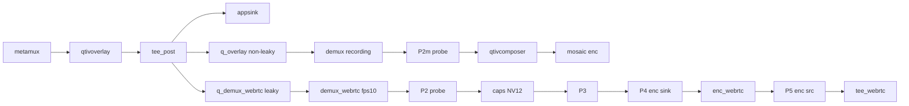

# WebRTC LIVE 无检测框：分析取证与修复计划（修订版）

## 专家意见真伪结论（整合依据）

| 专家条目 | 判定 | 依据 |
|----------|------|------|
| C1：不得把 demux `make_writable` 标为「先验最高」 | **真** | Mosaic/WebRTC 均走 `aiboxstreamdemux` 且 `output-fps>0` 时都调 `make_writable`（见下「已知矛盾」）；若单独成立则 mosaic demux 出口也应无框 |
| 强制 P2m 对照 | **真** | 无 P2m 无法区分「demux 共性伤害」vs「WebRTC 独有下游」 |
| INDEX §3 引用边界 | **真** | §3 历史证据是 tee **前** overlay/composer GLES 失败；tee **后** demux 的 `make_writable` 只能作候选，须像素裁决 |
| 官方 encode 示例不得等同「烧录后再插 composer」 | **真** | 示例是 camera + detection **两路合成**进 enc，非 overlay 后再桥接 |
| VPU 16+16+1=33 同跑被拒 | **真** | [`GstPipelineBuilder.cpp:776-792`](G:\Visteon\July.26\daily_record\7-22\IoT_pipleine\src\pipeline\GstPipelineBuilder.cpp) |
| P4=enc sink、P5=enc src | **真** | 原 plan 把 enc src 误当作「编码器输入」 |
| dump 须可执行（禁止含糊外部附着） | **真** | 当前无附着到已 PLAYING 进程的机制 |
| leaky 不能单独解释「有帧无框」 | **真** | 可丢帧/卡顿，不能单独结案缺框 |
| §1.10 不含「LIVE 可见检测框」 | **真** | 需求说明清单为信令/会话项；缺框须独立硬门禁 |

---

## 已证实事实（非假设）

| 结论 | 证据 |
|------|------|
| 检测框由 `qtivoverlay` 在 **tee 前** 对可写 buffer **原地** compose | QTI `overlay.c`：`set_in_place(TRUE)` + `gst_video_converter_engine_compose`；不可写 → `"not writable, skipping!"`（~1998–2000）且 `GST_FLOW_OK`；compose fence=NULL（~2026） |
| 框：Cairo→BGRA，再默认 **GLES** blit；compose 后无 `DMA_BUF_IOCTL_SYNC` / `engine_flush` | 同上 + QTI `gles-video-converter.cc` |
| Mosaic 与 WebRTC **共用** `qtivoverlay → tee_post`，其后分叉 | [`GstPipelineBuilder.cpp`](G:\Visteon\July.26\daily_record\7-22\IoT_pipleine\src\pipeline\GstPipelineBuilder.cpp) ~1022–1128 |
| Mosaic：`demux → qtivcomposer → enc`；WebRTC：`demux → caps(NV12) → enc`（无 composer） | `BuildGroupRecordingBranch` / `BuildWebrtcAnnotatedBranch` |
| 两路 demux **同一插件**；`output-fps>0` 时 `gst_buffer_make_writable` 仅改 PTS | [`gstaiboxstreamdemux.cpp:446-457`](G:\Visteon\July.26\daily_record\7-22\IoT_pipleine\plugins\aiboxstreamdemux\gstaiboxstreamdemux.cpp)；Mosaic `output-fps=opts_.mosaic_fps`（Builder **534–538**）；WebRTC `output-fps=10`（Builder **1404–1408**） |
| WebRTC `caps_webrtc` = `video/x-raw,format=NV12`（**未带** `memory:DMABuf`） | Builder **1466–1468** |
| VPU：`dec + webrtc_enc + rec_enc > 32` → `VPU_BUDGET_EXCEEDED` | Builder **776–792**；故 **16+16+1=33 禁止同跑** |
| 仓库/板端默认 labels 末字节均为 `FF` | 板端 `yolov26n_factory_labels.json`；**板端以实际 cat 为准** |
| QTI 色值字节序为 **`0xRRGGBBAA`**（非「ARGB 高位 Alpha」） | QTI [`common-utils.h`](G:\Visteon\July.26\Qualcomm_source_code_learning\gst-plugins-qti-oss-imsdk.lnx.2.0.0.r2-rel(not_changed)\gst-plugin-base\gst\utils\common-utils.h) L40–48：`EXTRACT_RED=(>>24)`，`EXTRACT_ALPHA=(color&0xFF)`。故 Green=`0x00FF00FF`→A=`FF`**不透明**；板端 `*_fixed.json` Green=`0xFF00FF00`→A=`00`**透明**——上下文「Green Alpha=0」若指原 JSON 则与官方宏矛盾 |
| Mosaic `q_overlay` 非 leaky；WebRTC `q_demux_webrtc` `leaky=2` | Builder **1096–1100** vs **1414** |
| 板端当前 IP | **`192.168.100.106`**（INDEX `.101` SSH 已超时；`.106` 实测可连且有 `IoT_poipeline`） |

### 已知矛盾 / 引用边界（禁止逻辑偷换）

**矛盾 C1：** 不得在取证前将「demux `make_writable` 丢掉 GLES 像素」标为最高先验或直接结案。两路 demux 在 `output-fps>0` 时行为同类；若该机制单独成立，mosaic demux 出口也应无框，除非另有证据证明「composer 之后把框找回来」或「两路 demux 出口像素不一致」。必须用 **P1 / P2 / P2m** 像素证据裁决。

**INDEX §3 边界：** [`plan/INDEX.md`](G:\Visteon\July.26\daily_record\7-22\IoT_pipleine\plan\INDEX.md) §3「禁止 DMA-BUF 上 `make_writable`」的历史证据是：拷贝脱离 DMA-BUF 后导致后续 **qtivoverlay/composer GLES 失败**（`"Failed to apply overlays!"`）。本问题中 `make_writable` 发生在 **qtivoverlay 之后**（tee 后 demux）。**不得**把「tee 前 overlay 失败」禁令直接等同为「tee 后 demux make_writable = LIVE 丢框」的证明。可列为候选机制，须 P1/P2/P2m 裁决。

**QTI encode 示例边界：** `gst-snpe-yolo-ssd-encode-example/main.cc` 中 `qtivcomposer` 用于 **摄像头支路 + 检测 overlay 支路合成** 再进 encoder；**不是**「`qtivoverlay` 烧录后再插 composer 做 DMA 桥」。Phase 2B 若建议加 composer，仅当本仓库逐跳取证证明需要 DMA 友好桥时的**候选**，不得写成「对齐官方即可证明正确」。

---

## 验收范围拆分（不得与缺框绑死）

需求说明 [`webrtc_需求说明.txt`](G:\Visteon\July.26\daily_record\7-22\WebRTC_JKY\webrtc_需求说明.txt) **§1.10 清单 1–14 不包含「LIVE 可见 AI 检测框」**。

### A. 缺框硬门禁（本轮必须 PASS，否则不关闭）

| ID | 要求 |
|----|------|
| BOX-S1 | 同跑 mosaic vs LIVE：同相机同窗口均可见检测框 |
| BOX-P* | 逐跳报告（含 **P2m**）归档至 `output/webrtc_box_diag_<ts>/` |
| BOX-R1 | 修复后 LIVE 可见 Human 框（Green 仅当 labels 不透明且模型检出） |
| BOX-R2 | close 后再开 session 框仍在；encoder 常开语义不被破坏 |

### B. §1.10 信令/会话清单

| # | 策略 |
|---|------|
| 1–8、10、14 | 纳入回归，期望 PASS（`test_webrtc_signaling` V* + LIVE） |
| 9 renegotiate、11 gathering 10s、12 COMPLETE 后 late candidate、13 TURN | 本轮若不实现：在 `acceptance_checklist.md` 标 **已知缺口/未实现**，不得假装 PASS；**不得**作为缺框修复前置 |

产出：`test/webrtc/acceptance_checklist.md` + BOX 说明；视觉证据 → `output/webrtc_box_diag_<ts>/`。

---

## Phase 0 — 环境填空 + 同跑对照

### 硬约束：VPU 预算

`total_vpu = dec_count + webrtc_enc_count + rec_enc_count`，`>32` 直接拒绝（Builder **776–792**）。

**禁止默认 16 路做 `--record + webrtc` 同跑**（16+16+1=33）。

**写死：使用 N 路且 `N+N+1 ≤ 32`；推荐 N=1（1+1+1=3）。**

### 环境填空表 + 板端只读核验结果（2026-07-30；原始输出见 `output/phase0_readonly_board_result.txt`）

| # | 项 | 结果 | 判定 |
|---|----|------|------|
| 1 | SSH / IP | `hostname=ubuntu`；`wlp1s0 inet 192.168.100.106/24`（INDEX `.101` SSH 已不可用） | **PASS** |
| 2 | 二进制 | `/mnt/workspace/IoT_poipeline/build/aibox_stream_pipeline_demo` 存在，`620632` bytes，mtime `Jul 24 05:54` | **PASS** |
| 3 | 无 `scale_webrtc` | `strings \| grep -c scale_webrtc` → **`0`** | **PASS** |
| 4 | `ENABLE_WEBRTC` | `build/CMakeCache.txt`：`ENABLE_WEBRTC:BOOL=ON`；二进制含 `WebRTC annotated preview enabled` / `VPU budget OK` 字符串 | **PASS** |
| 5 | 1cam webrtc 配置 | `pipeline_otm_1cam_webrtc.txt` **EXISTS**；`enabled_streams=1`；`[webrtc] enabled=1` → 同跑 VPU 预算 **1+1+1=3≤32** | **PASS** |
| 6 | labels 默认 + 模型路径 | 实际文件：`.../labels/yolov26n_factory_labels.json`；`yolov26n_factory_otm.txt` → `labels_path=.../yolov26n_factory_labels.json`；Green=`0x00FF00FF`（QTI `0xRRGGBBAA` → A=`FF`不透明）；Human=`0xFF0000FF`（A=`FF`） | **PASS**（非 alpha=0） |
| 7 | labels fixed（禁用） | `yolov26n_factory_labels_fixed.json` 存在；Green=`0xFF00FF00` → A=`00`**透明**。本轮同跑**禁止**使用 fixed / `pipeline_otm_1cam_webrtc_fixed.txt` | **PASS**（已识别禁用品） |
| 8 | plugins | `GST_PLUGIN_PATH` 约定目录含：`libgstaiboxstreamdemux.so`、`libgstaiboxtimemux.so`、`libgstqtimlpostprocess_roi.so` + `ml_modules/` | **PASS** |
| 9 | NATS | `1975 /usr/sbin/nats-server -c /etc/nats-server.conf`；`which`=`/usr/sbin/nats-server` | **PASS** |
| 10 | VPU 静态配置门禁 | 1cam：`enabled_streams=1`+webrtc；16cam overload 文件存在且 `enabled_streams=16`+webrtc — **禁止**用于 `--record` 同跑（16+16+1=33） | **PASS**（约束已确认） |

固定路径写死（后续命令直接用）：

- SSH：`ubuntu@192.168.100.106`
- ROOT：`/mnt/workspace/IoT_poipeline`
- 同跑配置：`config_snapshots/demo_2stage_yolo_serial/pipeline_otm_1cam_webrtc.txt`
- mosaic 输出：`--record /tmp/mosaic_diag.mkv`
- labels：默认 JSON（非 fixed）
- 本地核验脚本/结果：[`output/phase0_readonly_board.sh`](G:\Visteon\July.26\daily_record\7-22\IoT_pipleine\output\phase0_readonly_board.sh) / [`output/phase0_readonly_board_result.txt`](G:\Visteon\July.26\daily_record\7-22\IoT_pipleine\output\phase0_readonly_board_result.txt)

### overlay 日志门禁（有流后执行；本次 RTSP 不可用故延期）

`GST_DEBUG=qtivoverlay:5`；`"not writable, skipping!"` / `"Failed to apply overlays!"` 计数必须为 **0**。引用：QTI `overlay.c` ~1998–2000、compose fence=NULL ~2026。**状态：DEFERRED（等 RTSP）**。

### 同跑步骤与判定（等 RTSP）

1. 同一进程：1cam + `--record` + WebRTC + 浏览器 LIVE。
2. 同时间窗：mosaic MKV 截帧 + LIVE 截帧。
3. 判定：
   - mosaic 有框 + LIVE 无框 → Phase 1
   - 两者皆无 → 先查检测事件 / labels alpha / overlay 日志（非 WebRTC 支路）
   - 两者皆有 → 观感/分辨率问题，不做 DMA 猜修

### Phase 0 同跑结果（2026-07-30 重跑；训练同源视频；产物 `output/webrtc_box_diag_20260730_111017/`）

| 项 | 结果 | 证据 |
|----|------|------|
| 配置 | `pipeline_otm_1cam_webrtc.txt` + `--record /tmp/mosaic_diag.mkv` | 板端日志 |
| VPU | `1 dec + 1 webrtc_enc + 1 rec_enc = 3 / 32` | `phase0_run.log` |
| overlay 门禁 | `not writable, skipping!`=**0**；`Failed to apply overlays!`=**0** | 同日志 |
| 检测量 | events=1937；**with_detections=404**；labels **Green=1584, Human=303** | `output/events.jsonl` |
| RTSP | `h264,640,480`（训练同源） | ffprobe |
| mosaic 截帧 | **有框**：Human（红）+ 多处 Green | `mosaic_frame_t08.png` / `mosaic_frame_t15.png` |
| LIVE | ICE connected；出画 640×480；**未见检测框** | `live_browser.png`（浏览器截屏，ICE connected 同时段） |
| **判定** | **mosaic 有框 + LIVE 无框 → 进入 Phase 1** | 同跑对照成立；丢框点在 `tee_post` 之后 WebRTC 支路（或观感误判须由 P1–P5 排除） |

说明：同日更早一轮（`..._110223`，非训练源）检测极少（with_det=6），作废，不以该轮结案。

**状态：Phase 0 同跑 PASS（分支已选定）。**

---

## Phase 1 — 逐跳像素取证

### 探针表（强制含 P2m；P4/P5 拆分）

| ID | Pad | 目的 |
|----|-----|------|
| P1 | `overlay_*` src 或 `tee_post` sink | 烧录后是否有框 |
| P2 | `demux_webrtc_*` src_N | WebRTC demux（含 make_writable）后是否有框 |
| **P2m** | `demux_*`（recording）src_N | Mosaic demux 后、**composer 前**是否有框（强制） |
| P3 | `caps_webrtc_*` src（enc sink 前） | caps/隐式转换后是否有框；记录 current-caps 是否含 `memory:DMABuf`/`GBM` |
| P4 | `enc_webrtc_*` **sink**（编码输入 raw） | 编码器**输入**像素是否有框 |
| P5 | `enc_webrtc_*` **src**（H.264）抽关键帧解码 | 编码后码流是否仍有框 |
| 对照 | mosaic composer 后 / mosaic MKV 同时间窗截帧 | 同跑视觉对照 |

每跳 dump 同时保存：1–3 帧图像（NV12→PNG 或 raw）、`gst_pad_get_current_caps` 全文、buffer 是否 DMA（caps features / memory 类型日志）。产物：`output/webrtc_box_diag_<ts>/`；报告写明 **首个无框跳**。

### 判定规则（替换原「P2 无框即钉 demux」）

- P1 有框 + P2 无框 + **P2m 无框** → 再查「为何 mosaic 最终有框」（重点 `qtivcomposer` 是否重绘/同步），**禁止**直接结案 demux `make_writable`。
- P1 有框 + P2 无框 + **P2m 有框** → 同一 demux 插件行为不足以解释差异，必须继续查 WebRTC 独有下游（caps/隐式 convert/enc），**不得先改 demux**。
- P1 有框 + P2 有框 + P3/P4 无框 → 根因在 caps/enc 前路径。
- P4 有框 + P5 无框 → 编码器本身丢信息（少见，需单独证）。
- P5 有框 + 浏览器无框 → 非烧录问题。

### dump 实现（可执行；诊断阶段仅允许取证改动）

**禁止**依赖「外部进程附着到已 PLAYING 的 pipeline 元素名」且不说明机制。

二选一（宏/环境变量**默认关闭**，不得默认改拓扑）：

- **A（首选）**：主程序/Builder 旁路 pad-probe dump；`AIBOX_WEBRTC_PAD_DUMP=1` 时对 P1–P5/P2m 采样后自动卸探针。
- **B**：临时诊断 bin：指定 pad 后旁路 `queue→videoconvert→pngenc/multifilesink`（仅诊断构建）。

诊断阶段仍 **禁止**：为猜修改 videoscale / 去 caps / 改 leaky / 加 converter。允许的代码改动 **仅限取证探针**。

### 路径差异清单（报告中逐项「已测/未测」；未取证禁止改）

1. Mosaic：`demux → qtivcomposer → enc`；WebRTC：`demux → caps(NV12,无 memory:DMABuf) → enc`（无 composer）— Builder 两分支
2. `q_overlay` 非 leaky vs `q_demux_webrtc` leaky=2 — **1096–1100** vs **1414**
3. 二者 demux 均可能 `make_writable`（`output-fps>0`）
4. WebRTC 无 videoscale（当前回滚）

leaky 差异可导致丢帧/卡顿，**不能单独解释**「到达的帧上无框」；未取证禁止改 leaky。

---

## Phase 2 — 修复门禁（无「先验 2A」）

**只有 Phase 1 报告出具后才能改业务代码**；按报告钉死的那一跳最小修复。

### 受控实验（钉死前可做；实验≠结案）

- **W1**：仅 WebRTC demux 设 `output-fps=0`（跳过 `make_writable` 路径），同跑看 LIVE 是否出框；同时记录 mosaic 时长/PTS 是否回归。
- **W2**：caps 加/不加 `memory:DMABuf`（或板端实际 feature）时，记录 P3 caps features 与像素差异。

### 修复候选（仅证据匹配时启用）

- **2A**：仅当 P2/P2m 证据支持 demux PTS 拷贝策略有害，且修复不破坏 mosaic phase5 门禁。
- **2B**：仅当 P2 有框而 P3/P4 无框，或 caps 丢失 DMA feature 与丢框同跳出现；**composer 仅为候选桥**（非「对齐官方」），且须 VPU 复核（`N+N+1≤32`；per-cam composer 须重算会话）。
- **2C**：仅当 Phase 0 证明板端 labels alpha=0；仓库 JSON `FF` 不得当成板端已修复证明。

**关闭条件：** 同一进程同跑，**BOX-S1** 通过。

---

## Phase 3 / 4

- Phase 3：BOX-S1/P/R + `test/webrtc/acceptance_checklist.md`（缺口书面记录）。
- Phase 4：更新 `plan/INDEX.md`——只写「经 Phase1 证明的根因一句 + 源码/dump 引用」；删除「仅怀疑 DMA」表述。

---

## 执行顺序

1. 填空并确认 **1cam**（或 `N+N+1≤32`）同跑环境 + labels 色值 + overlay 日志门禁  
2. Phase 0 同跑截帧判定分支  
3. 实现可开关 pad dump → 产出含 **P2m** 的逐跳报告（**先报告后改业务代码**）  
4. 按报告最小修复 + 必要受控实验 W1/W2  
5. BOX-S1/R1/R2 关闭 + §1.10 已覆盖项回归；缺口项书面记录  
6. 更新 `plan/INDEX.md`：经证明根因 + 引用  

完成后回贴：更新后 plan 路径 + Phase0/1 报告路径。

---

## 执行状态（2026-07-30）

- **Plan 修订**：已按专家八节意见全文整合（本文件）。
- **Phase 0 板端只读核验（#1–#10）**：**全部 PASS**。
- **Phase 0 同跑**：**PASS → mosaic 有框 + LIVE 无框**（`output/webrtc_box_diag_20260730_111017/`）。
- **Phase 1 pad-dump**：**已完成一轮**（`output/webrtc_box_diag_20260730_112203/` + `PHASE1_REPORT.md`）。
  - P1=P2=P2m=P3=P4 有框且 MD5 相同 → **排除 demux `make_writable` 单独根因**。
  - P5/P5b 码流无 SPS/PPS，离线无法目视编码后是否有框。
  - **禁止**据此改 demux；下一候选为 enc 前 DMA 同步/composer 桥实验（须另开受控实验）。
- **Phase 2**：**未开始**（等 P5 可解码证据或用户批准受控实验 W-composer）。
