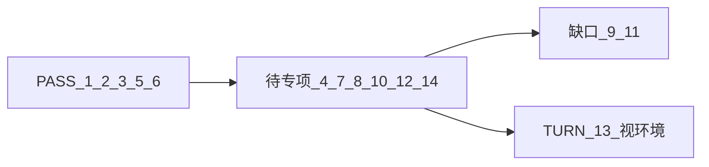

# §1.10 验收清单现状 + 详细测试计划

依据：[webrtc_需求说明.txt](G:/Visteon/July.26/daily_record/7-22/WebRTC_JKY/webrtc_需求说明.txt) **§1.10**；对照仓库 [acceptance_checklist.md](test/webrtc/acceptance_checklist.md) 与实现（`WebrtcSignaling` / `WebRtcSession`）。

说明：TXT 的正式验收表是 **§1.10 的 14 项**。缺框 BOX-* / 三路 MULTI 是本仓库额外硬门禁，**不是**该 TXT 的 §1.10 条目，文末单独标注。

---

## 一、你已经通过了哪些（§1.10）

| # | TXT 要求 | 当前结论 | 依据 |
|---|----------|----------|------|
| 1 | 订阅 `session.new` | **PASS** | 启动日志 `Subscribed to 4 wildcard subjects`；现场 `RX: session.new` |
| 2 | `session.new` → ≤5s Offer | **PASS** | 浏览器 Offer received；板端 `Offer created` |
| 3 | 立即发 `ice.local` ×N | **PASS** | 板端多条 `ICE local: mline=...` |
| 5 | answer → set-remote | **PASS** | 双侧 ICE `connected/completed` |
| 6 | `ice.remote` → add-candidate | **PASS** | 同上（依赖 ICE 成功） |

**相关但非 §1.10：** BOX-P1/P5/S1/R1/R2、MULTI-3CAM 均已 PASS（见 checklist A/D）。

---

## 二、尚未闭环 / 预期会挂的项

| # | TXT 要求 | 现状 | 测试期望 |
|---|----------|------|----------|
| 4 | gathering complete 发 `candidate:""` | 代码在 `OnIceGatheringStateChange(COMPLETE)` 会发空 candidate；**未专项归档** | 可测，预期大概率 PASS |
| 7 | 发 `session.state`（含 ice/peer 字段） | `PublishState` / ICE 回调已有；**未核对 NATS JSON 字段** | 可测，预期大概率 PASS |
| 8 | close → 释放且不影响同 cam 其他 session | Close 可用；**资源/并发未专项证** | 可测（与 #10 联动） |
| 10 | 同摄像头双并发 session | `max_sessions_per_camera=2` + tee；**未测** | 可测，关键回归项 |
| 12 | COMPLETE 后 late candidate 不丢 | 仍监听 `OnIceCandidate`；**未专项测** | 可测（难稳定复现，需日志/探针） |
| 14 | Offer 前 close 安全 | **未测** | 可测，预期应 PASS（不崩溃） |
| 9 | `renegotiate` → ≤500ms 新 Offer | **未订阅**（仅 4 个 subject，无 `*.renegotiate`） | **预期 FAIL（缺口）** |
| 11 | 10s gathering 超时强制 end-of-candidates | 有 timer，但 `IceTimeoutCb` **几乎是空壳**（未真正 pub 空 candidate） | **预期 FAIL（半实现）** |
| 13 | `ice_servers` 含 TURN 正确配置 | 代码会 `g_object_set(turn-server, ...)`；缺现网 TURN 时只能验“配置生效日志” | 有 TURN 服务则功能测；否则记 **配置路径 PASS / 连通性 BLOCKED** |



---

## 三、测试环境与统一门禁（每轮必做）

**板端**
- Host：`ubuntu@192.168.100.106`，工程 `/mnt/workspace/IoT_poipeline`
- `export GST_PLUGIN_PATH=$ROOT/plugins`
- 快照：`config_snapshots/demo_2stage_yolo_serial/pipeline_otm_1cam_webrtc.txt`（双 session 也用 1cam）
- `python3` 打开 `/dev/video32` 成功；`pgrep nats` 有进程
- HTTP：`cd test/webrtc && python3 -m http.server 8080`
- 启动示例：
  ```bash
  ./build/aibox_stream_pipeline_demo \
    --snapshot ./config_snapshots/demo_2stage_yolo_serial/pipeline_otm_1cam_webrtc.txt \
    --run-seconds 180
  ```

**客户端**
- 浏览器：`http://192.168.100.106:8080/webrtc-test.html`（NATS 默认 `.106`）
- 自动化：headed Chrome + Playwright（**禁止** headless / Cursor browser MCP 长等待）
- 每步硬超时建议 **≤150s**；失败立刻换测法，不空等

**证据目录**
- `output/webrtc_1_10_<ts>/`：`run.log`、浏览器日志截图、`nats_capture.txt`、各 case 的 `CASE_xx.md`

**NATS 旁路抓包（强烈建议）**
- 另开终端订阅：
  ```bash
  nats sub 'webrtc.cam.cam-001.session.>'
  ```
  归档原始 JSON，作为 #4/#7/#8/#11/#12 的主证据。

---

## 四、分阶段详细用例

### Phase 0 — 基线复测（确认 #1/#2/#3/#5/#6 仍绿）

1. 启管道 + 开 `webrtc-test.html` → Start LIVE  
2. **Pass**：≤5s 见 Offer；板端 `RX: session.new`；多条 `ICE local`；ICE → connected；视频有帧  
3. 归档：浏览器 log + `run.log` 片段 → 记 `CASE_01_06_baseline.md`（可引用历史 PASS，但本轮至少 spot-check 一次）

### Phase 1 — 可专项闭环（优先执行）

**CASE-04：gathering complete → `candidate:""`**
- 步骤：一次正常建连；在 `nats sub` 中找该 `session_id` 的 `ice.local`  
- Pass：至少一条 `candidate` 为空字符串（或板端日志 `cand=(empty/end)`），且出现在 gathering complete 之后  
- Fail：只有非空 candidate，无空 candidate

**CASE-07：`session.state` 字段**
- 步骤：建连过程抓 `...session.{sid}.state`  
- Pass：JSON 含 `camera_id`/`session_id`/`ice`/`peer`；至少经历到 `ice`∈{connected,completed}（或 checking→connected）  
- Fail：无 state 消息，或字段名/枚举不符合 TXT 第二节

**CASE-08：close 释放**
- 步骤：建连成功后浏览器 Close；确认 NATS 收到/板端处理 `session.close`；再 Start 新 session 仍可连  
- Pass：板端 `Closing`；旧 session 不再产 ice/state；新 session Offer 正常；进程不崩  
- 加强：与 CASE-10 一起证明“只释放目标 session”

**CASE-10：同摄像头双并发 session**
- 步骤：同一 `cam-001` 开两个独立标签/两行 tile（两套不同 `session_id`），同时 Start  
- Pass：两路均 ICE connected + 出画；Close 其中一路，另一路仍 LIVE；板端两路 tee pad 互不杀  
- Fail：第二路无 Offer / 第一路被踢 / 崩溃  
- 工具：可扩 `webrtc-test-multi.html` 为双 tile 同 cam，或两个浏览器窗口

**CASE-14：Offer 前 close**
- 步骤：发 `session.new` 后立刻发 `session.close`（可用 nats pub 脚本，不等 Offer）；或 Start 后立刻 Close  
- Pass：进程不崩、无泄漏崩溃循环；后续正常 Start 仍可用  
- Fail：segfault / 卡死 / 后续无法再建 session

**CASE-12：COMPLETE 后 late candidate（尽力）**
- 步骤：正常建连；在 gathering complete（空 candidate）之后，若板端仍打印新的 `ICE local` 非空，确认仍 pub 到 NATS 且浏览器未因丢弃导致异常  
- Pass：late candidate 仍出现在 NATS（或明确日志证明仍回调），会话保持 connected  
- 若环境从不产生 late candidate：记 **N/A + 代码仍注册 OnIceCandidate**，不标 PASS

### Phase 2 — 缺口项（按 TXT 方法测，允许 FAIL）

**CASE-09：renegotiate ≤500ms**
- 步骤：`nats pub` 符合 TXT 的 `session.renegotiate`（含 `resolution.width/height/max_kbps`）  
- Pass：≤500ms 新 Offer；分辨率/码率可见变化  
- **预期 Fail**：无订阅、无处理日志 → 记 **已知缺口**，回写 checklist #9

**CASE-11：10s gathering 超时**
- 步骤：阻断 STUN/外网或使 gathering 挂起（防火墙/错误 stun）；测是否约 10s 强制空 candidate  
- Pass：约 10s 内出现强制 `candidate:""`，协商不永久阻塞  
- **预期 Fail**：仅日志 `ICE gathering timeout` 但无空 candidate pub（与当前 stub 一致）→ 记半实现

**CASE-13：TURN**
- 若有可用 TURN：在 `session.new.ice_servers` 加入 `turn:...` + username/credential；必要时强制非直连路径  
- Pass：板端日志 `TURN: ...`；ICE connected（或 relay candidate 出现）  
- 无 TURN：只验 JSON 解析 + 日志配置路径，连通性标 **BLOCKED**，不得伪 PASS

### Phase 3 — 文档回写

- 更新 [acceptance_checklist.md](test/webrtc/acceptance_checklist.md) B 区：把本轮实测结果从“待回归/已知缺口”改为 PASS/FAIL/N/A，并挂证据路径  
- 产出总表：`output/webrtc_1_10_<ts>/SECTION_1_10_MATRIX.md`（14 行一一对应 TXT）

---

## 五、建议执行顺序（一天内可跑完验证项）

1. Phase 0 基线（15–20 min）  
2. CASE-04 + CASE-07（同一次建连，NATS 抓包）  
3. CASE-14 → CASE-08 → CASE-10（会话生命周期）  
4. CASE-12（顺带观察）  
5. CASE-09 / CASE-11（预期 FAIL，留缺口证据）  
6. CASE-13（有 TURN 再做）  
7. 回写 checklist + MATRIX

**不做进本测试计划的开发**（除非另开实现任务）：补 `renegotiate` 订阅与处理；把 `IceTimeoutCb` 真正 pub 空 candidate；TURN 服务器部署。

---

## 六、与“缺框/多路”的关系（避免混淆）

- TXT §1.10 = **信令/会话协议验收**  
- BOX-* / MULTI = **媒体带框与多路预览**（已 PASS）  
- 本计划以 TXT §1.10 为准；BOX/MULTI 无需重测，除非回归时抽查 LIVE 有框
