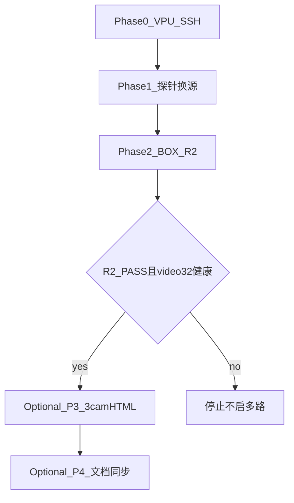

# 换 RTSP + BOX-R2 +（可选）三路 HTML 预览实施计划

## 既定结论（不改动）

- 缺框根因已否定「WebRTC/tee 系统性丢框」；[BOX-S1 带 record](output/webrtc_box_diag_20260731_025631/BOX_S1_RECORD_REPORT.md) 已 PASS（证据在 **cam0**）。
- 换源后 **不必强制重跑 S1**；R2 归档注明新 RTSP path 即可。
- **禁止**改 demux / 强加 composer；**禁止**用 `pipeline_webrtc_16cam_overload.txt`。
- 当前阻塞：板端 `/dev/video32` OOM / SSH 可能超时——**Phase 0 必须先恢复连通与 VPU**。

## 架构与执行顺序

**硬路径（关闭 BOX-R2）**：P0 → P1 → P2。  
**可选增强（P3/P4）**：仅当 R2 **PASS** 且 `/dev/video32` 仍健康后再做。



硬门禁验收（BOX-R2）始终走 **1cam**；三路 HTML 不替代 R2。

---

## Phase 0 — 板端门禁（阻塞项）

目标：`ubuntu@192.168.100.106` SSH 通，且 `/dev/video32` 可 `O_RDWR` 打开。

1. 恢复网络/板卡（必要时复位）；清理残留 demo 时**优先**让 `--run-seconds` 正常退出，**禁止**习惯性 `kill -9`（仅僵死进程才强制杀，之后必须重验 video32）。
2. 冷静后验证：
   - `python3` 打开 `/dev/video32` 成功
   - `pgrep nats` 有进程
3. **HTTP 8080**：Phase1 扫 RTSP **不依赖**；延后到 Phase2（R2）/ Optional P3 再起 `python3 -m http.server 8080`。
4. 未通过则**停止**，不扫流、不启管道。

---

## Phase 1 — 换 RTSP（先肥源，再 R2）

### 1.1 现状

- 推流机：`192.168.100.113:8554`，path `cam0`…`cam15`
- 现成映射：`streams/cam-001-otm2.txt`→cam0 … `cam-00N-otm2.txt`→cam(N-1)（至少到 cam8）
- 板端：`pipeline_otm_1cam_webrtc.txt`（`enabled_streams=1`，`[webrtc] enabled=1`）；仓库本地可能缺此文件，**板端有即可**，Optional P4 再同步仓库。

### 1.2 扫描（禁止改脏 `cam-001-otm2.txt`）

对 cam0–cam5（对应 `cam-001`…`cam-006` 的 otm2 文件）各短跑一次（**无 `--record`**，VPU `1+1+0=2`）：

1. **临时 1cam 快照**（例如 `/tmp/probe_1cam_webrtc_<N>.txt`）：从板端 `pipeline_otm_1cam_webrtc.txt` 复制，仅改 `[streams] include=` 为**现成** `streams/cam-00N-otm2.txt`（不改该 stream 文件内 `rtsp_url`）。
2. 启动：
   ```bash
   ./build/aibox_stream_pipeline_demo \
     --snapshot /tmp/probe_1cam_webrtc_<N>.txt \
     --run-seconds 30
   ```
   优先等进程**正常退出**；避免 `timeout`+`kill -9` 打断 VPU。
3. **AGG 指标（仅此）**（`ResultAggregator` 只有 `detections=%llu`，**无类别名**）：
   - 有检行数：最新语义下 `detections` 字段 **≠ 0** 的 AGG 行数（实现上可用 `detections=[1-9]` / 解析字段 ≠0）
   - 最大连续有检窗口（按 AGG 帧序号估算）
   - **不要**把「是否出现 Human」写成 AGG 指标
4. **每轮探针结束后必须再验 `/dev/video32`**：
   - 仍 OK：冷静 **≥8s** 作为下限后再跑下一 path
   - 打开失败：**立刻回 Phase 0**（复位/加长冷静），禁止继续扫流
5. Human/Green 仅在后续 LIVE 像素或目视中作辅证，不进探针排序主分。

产出：`output/webrtc_box_diag_<ts>/rtsp_probe_summary.md`（path / camera_id → 有检次数、连续窗、video32 状态）。

### 1.3 固化换源（互不相同 top1/2/3）

1. 按有检密度排序；并列优先**连续有检窗更长**者；全差则主路保留 cam0 并在报告注明。
2. 取 **互不相同** 的 top1/top2/top3 path，分别写入：
   - `cam-001-otm2.txt` ← top1（R2 主路）
   - `cam-002-otm2.txt` ← top2
   - `cam-003-otm2.txt` ← top3  
   避免「主路改成 cam1 而 cam-002 仍是 cam1」的同 path 撞车。写入时保留原 URL 注释。
3. 正式 1cam webrtc 快照仍 `include=streams/cam-001-otm2.txt`（已指向 top1）。
4. 冒烟：用正式 1cam 快照再跑 30s，确认曾出现 `detections≠0`；结束后再验 video32。

临时 `/tmp/probe_*.txt` 用完可删；**不**在探针循环里改写共享 stream 文件。

---

## Phase 2 — BOX-R2（Close→Start 仍有框）

### 2.1 前置

- video32 OK；启动 HTTP 8080（若未起）
- 浏览器先开 [webrtc-test-autostart.html](test/webrtc/webrtc-test-autostart.html)（NATS `ws://192.168.100.106:8443`），再启管道

### 2.2 跑法（1cam，优先无 record）

```bash
./build/aibox_stream_pipeline_demo \
  --snapshot ./config_snapshots/demo_2stage_yolo_serial/pipeline_otm_1cam_webrtc.txt \
  --run-seconds 120
```

1. **真重叠门禁**：日志**最新**一行 `[AGG]` 的 `detections` **≠ 0**，且 `ICE connection: connected|completed`（禁止用历史有检行冒充现窗）。
2. Session1：画布命中（`strictGreen>15` 或 `strictRed>200` 或 `softG>80`）+ 目视 → `live_r2_s1.png`。
3. 立刻 `Close` → `Start`（页内脚本串行）。
4. Session2：同样门禁 → `live_r2_s2.png`；板端第二次 `New session` + ICE。
5. 归档：`output/webrtc_box_diag_<ts>/`（`run.log`、两张图、`true_overlap*.txt`、**RTSP path / camera_id**）。

### 2.3 可选加跑

VPU 稳定后，同一主路加 `--record` 再跑 R2（VPU `1+1+1=3`），非 R2 硬门槛。

### 2.4 通过标准

- S1/S2 均目视有框 + 像素门禁  
- checklist BOX-R2 → **PASS**（注明新 path；S1 仍引用 cam0 证据即可）

---

## Optional Phase 3 — 三路 HTML 预览 + 3cam 配置

**进入条件**：Phase2 R2 **PASS**，且当前 `/dev/video32` 健康。

**方案**：新建 **3cam+webrtc**，三路 WebRTC 带框预览；默认**不** `--record`（VPU `3+3+0=6`）。stream 文件已是 Phase1 固化的互异 top1/2/3。

### 3.1 配置

- 新增 `pipeline_otm_3cam_webrtc.txt`（模板来自板端 1cam webrtc）：`enabled_streams=3`，`[webrtc] enabled=1`，include `cam-001/002/003-otm2.txt`
- 日志：`VPU budget OK: 3 dec + 3 webrtc_enc + 0 rec_enc = 6 / 32` + 三路 `tee_webrtc`

### 3.2 HTML

- 新建 `test/webrtc/webrtc-test-multi.html`：三格独立 session；`Start All` / `Close All`；NATS 默认 `.106`
- 单路 `webrtc-test.html` 默认 NATS 改为 `.106`

### 3.3 冒烟

Start All → 三路 ICE+出画；至少一路真重叠下有框；证据 `multi_*`。失败或 video32 异常则中止，不影响已 PASS 的 R2。

---

## Optional Phase 4 — 清单与文档

**进入条件**：P2 完成；P3 若做了则一并归档。

- 更新 [acceptance_checklist.md](test/webrtc/acceptance_checklist.md)：R2 PASS + 新 path；可选写三路预览
- 仓库同步：板端 `pipeline_otm_1cam_webrtc.txt`（若本地缺失）、stream URL 变更、`pipeline_otm_3cam_webrtc.txt`、multi HTML
- §1.10 双 session 同相机仍未测

---

## 风险与纪律

| 风险 | 对策 |
|------|------|
| VPU OOM | Phase0；探针后必验 video32；失败回 P0；禁习惯性 kill -9 |
| 脏 URL / 同 path 撞车 | 探针只用临时快照 include；固化互异 top1/2/3 |
| AGG 无类别 | 探针只看有检密度/连续窗；类别靠 LIVE 目视 |
| 假阳性重叠 | 只用**最新** AGG 且 detections≠0 |
| 检测窗短 | autostart 先于管道；换肥源 |
| 多路拖死硬路径 | P3/P4 可选，R2 后且 video32 OK 才做 |

## 非目标

- 不改 demux / overlay / encoder 业务逻辑  
- 不做 TURN / renegotiate / 16 路  
- 不把 3cam 预览当作 BOX-S1/R2 替代证据  
- 换源后不强制重跑 S1  
