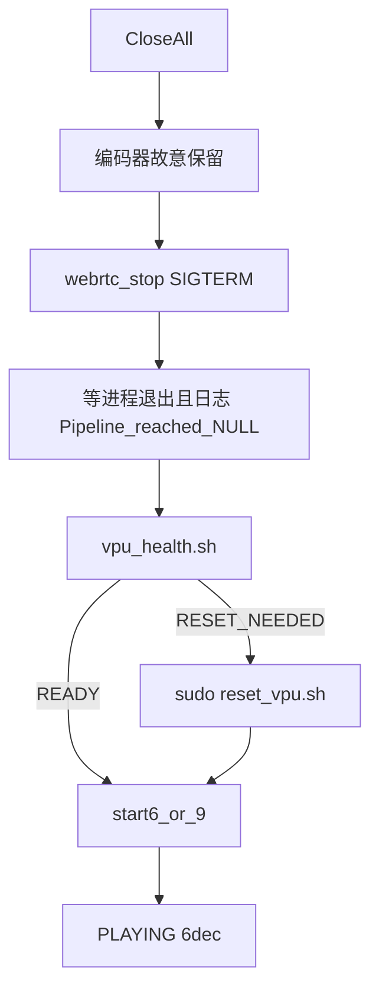

# 脚本侧 VPU 会话统计与复位

## 约束（C++ 不动）

- Close All **继续不关编码器**：[`SessionManager::MaybeTeardownEncoder`](src/webrtc/SessionManager.cpp) 保持 skip。预览关了，Venus 仍由整管 `NULL` 释放。
- 进程内不 `modprobe`、不 SIGKILL 热路径。硬件复位只发生在 **demo 已退出之后** 的 shell runner。
- 不照抄旧 [`prep_env.sh`](G:/Visteon/August_26/IoT_pipleine/.worktrees/control-295e2e1-camsplit/scripts/prep_env.sh) 的 `killall -9` 作为默认 stop；那会毁掉证据并误杀其它 gst。本仓现有 [`reset_vpu.sh`](scripts/reset_vpu.sh) 的 holder 门禁保留，只在「进程已死仍占 video32」或显式 `AIBOX_ALLOW_HOLDER_KILL=1` 时才 `fuser -k`。

## 问题

当前 [`webrtc_stop.sh`](scripts/webrtc_stop.sh) 只等进程消失；[`webrtc_prep.sh`](scripts/webrtc_prep.sh) / [`webrtc_inspect.sh`](scripts/webrtc_inspect.sh) / start6/9 只用一次 `open(/dev/video32)`。泄漏未到 32 时永远 `OPEN_OK`，第二次 PLAYING 再抢 6 路解码就会卡死/重启。默认 `AIBOX_VPU_RESET_POLICY=never` 把唯一固件复位路关掉了。

## 新共享探针：[`scripts/vpu_health.sh`](scripts/vpu_health.sh)

参考旧 [`reset_vpu.sh`](G:/Visteon/August_26/IoT_pipleine/.worktrees/control-295e2e1-camsplit/scripts/reset_vpu.sh) 的诊断段 + [`monitor_resources.sh`](G:/Visteon/August_26/IoT_pipleine/.worktrees/control-295e2e1-camsplit/scripts/monitor_resources.sh) 的一拍资源，输出可 `source` 的键值（禁止只靠 OPEN_OK）：

- `DEMO_ALIVE`：`pgrep aibox_stream_pipeline_demo`
- `VIDEO32_HOLDERS` / `VIDEO33_HOLDERS`：`fuser`
- `IRIS_REFCNT`：`lsmod` 里 `iris_vpu` 第 3 列
- `VPU_OPEN`：现有 open/close
- `CMA_FREE`：`/proc/meminfo`
- `DMESG_HIT`：最近 `already running|failed to add session|max limit|Cannot allocate`
- `LAST_NULL`：最新 `p6/p9/p3` 日志是 `Pipeline reached NULL` 还是 `did not reach NULL cleanly`
- `VERDICT`：`READY` / `RESET_NEEDED` / `BLOCKED_LIVE_DEMO`

`RESET_NEEDED`（仅当 demo 已死）：holders 非空，或 `VPU_OPEN=FAIL`，或 `LAST_NULL=dirty`，或 `DMESG_HIT` 命中。`IRIS_REFCNT` 只打印对比、不单独触发（空载基线未标定，避免误复位）。

## [`scripts/webrtc_stop.sh`](scripts/webrtc_stop.sh)

1. 仍先 `SIGTERM`，grace 默认 30s。
2. 额外等日志 `Pipeline reached NULL` 或 `Shutdown complete`（最多与 grace 重叠）。
3. 进程没了 → `source vpu_health.sh`；`RESET_NEEDED` 则 `sudo -n bash scripts/reset_vpu.sh`（无密码则打印 `RESET_NEED_SUDO` 并非 0）。
4. 进程仍在 → `STUCK_NEED_GDB`（默认仍不 -9）。仅 `AIBOX_STOP_FORCE=1` 时对 **本 demo PID** `fuser -k /dev/video32` 后再 reset，不 `killall -9 gst-launch`。

## [`scripts/webrtc_prep.sh`](scripts/webrtc_prep.sh)

对齐旧 [`prep_env.sh`](G:/Visteon/August_26/IoT_pipleine/.worktrees/control-295e2e1-camsplit/scripts/prep_env.sh) 的「启动前卫生」，但默认 **不** 无条件 reset Weston/VPU：

- 修正 `AIBOX_ROOT` 默认为 `/mnt/workspace/8-14/IoT_pipleine0814`。
- 写 `/tmp/aibox_wayland.env`（含 Adreno EGL 路径，与 force-on 脚本一致）。
- Weston 未起且 socket 死：清陈旧 socket；仅 `AIBOX_WESTON_RESET_POLICY=if-needed` 时才调板端已有 weston 脚本（不把 `_start_adreno_weston_forceon.sh` 整份拷进来，避免绑死 7-31 路径）。
- 打印完整 `vpu_health`；若 `VERDICT=RESET_NEEDED` 且 `AIBOX_VPU_RESET_POLICY` 为 `if-needed`/`always`，执行 `reset_vpu.sh`。

## [`scripts/webrtc_inspect.sh`](scripts/webrtc_inspect.sh)

- 同样修正 `AIBOX_ROOT`。
- 在现有日志关键字外增加：`did not reach NULL`、`ENOMEM`、`first-frame TIMEOUT`、`BUILDING→FAILED`、`skip encoder teardown`。
- 附带一拍 `vpu_health`（CMA / iris_refcnt / holders / VPU_OPEN / LAST_NULL）。不改成常驻 `monitor_resources` 循环。

## start 脚本（你选了 start 前自动复位）

改 [`webrtc_start6.sh`](scripts/webrtc_start6.sh)、[`webrtc_start9.sh`](scripts/webrtc_start9.sh)、[`webrtc_start3.sh`](scripts/webrtc_start3.sh)：

- `AIBOX_VPU_RESET_POLICY` 默认改为 `if-needed`（可用环境变量盖回 `never`）。
- `STOP_PREV` 之后、起 demo 之前：`vpu_health`；`RESET_NEEDED` 则 `sudo reset_vpu.sh`，失败则 **拒绝启动**（避免再走 BOOT_OK 后打挂板子）。
- `VPU=OPEN_OK` 保留为必要但不充分条件，必须 `VERDICT=READY` 才 `nohup` demo。

## [`scripts/reset_vpu.sh`](scripts/reset_vpu.sh)

保持现有保守门禁（有 holder 且未授权则 exit 20）。start/stop 在确认 demo 已死后设 `AIBOX_ALLOW_HOLDER_KILL=1` 再调。仍然：**不要每次清 GST 缓存**（与参考脚本第 4 步相同）。

## 验收（板端，不改产品 C++）

1. 干净 6 路：start → Start All 六路 READY → `inspect` 有 holders + 高 `IRIS_REFCNT`。
2. Close All：编码器仍在（日志 `skip encoder teardown`），`inspect` 仍应看到 video32 holder（符合你的要求）。
3. `webrtc_stop.sh`：进程退出 + `LAST_NULL=clean` + `VERDICT=READY` 或自动 reset 后 READY。
4. 人为脏状态（停不干净/上次 `did not reach NULL`）：再 `start6` 必须先打出 reset 日志，而不是直接 `BOOT_OK` 后挂死。
